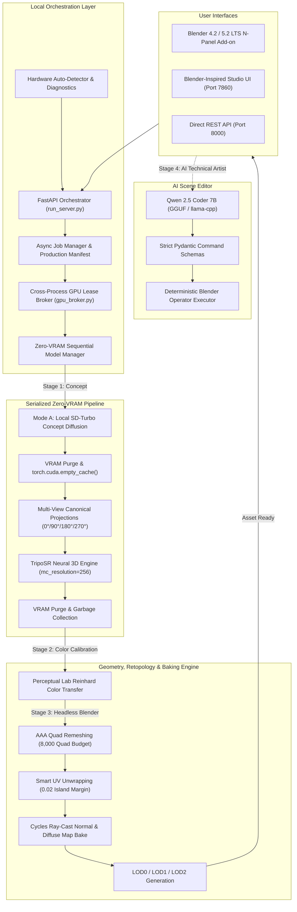

# Local Mesh AI 🚀
### Local-First Neural 3D Asset Generation & AI Technical Artist Studio

[](BEGINNER_GUIDE.md)
[](LICENSE)
[](https://www.python.org/)
[](https://pytorch.org/)
[](https://www.blender.org/)
[](tests/)

---

### 🧭 Navigation & Documentation
[**📖 Beginner Guide**](BEGINNER_GUIDE.md) • [**🛠️ Contributing**](CONTRIBUTING.md) • [**📜 License**](LICENSE) • [**🏗️ Architecture**](#system-architecture) • [**❓ FAQ**](BEGINNER_GUIDE.md#11-frequently-asked-questions-faq) • [**📚 3D Glossary**](BEGINNER_GUIDE.md#12-beginner-3d-graphics-glossary)

---

**Local Mesh AI** is an open-source, local-first 3D asset generation, inspection, and editing suite designed for local consumer and workstation GPUs. Generate watertight, color-accurate, PBR-textured 3D models directly from pure text prompts or reference images with **zero cloud dependencies** and **zero subscription fees**.

---

## 🔰 Beginner Guide (Quick Start & Fundamentals)

> New to 3D generation, AI models, or Blender? Local Mesh AI is built with 1-click batch runners, an interactive in-app tour, and beginner presets.
>
> 📖 **[Read the Full Beginner Operations Manual & 3D Glossary](BEGINNER_GUIDE.md)**

### 🚀 3-Step Quick Start
1. **Setup Environment:** Double-click [`launchers/1_setup_environment.bat`](launchers/1_setup_environment.bat) (creates virtual environment and installs all dependencies).
2. **Verify Hardware:** Double-click [`launchers/2_detect_hardware.bat`](launchers/2_detect_hardware.bat) (scans GPU, VRAM, and locates Blender).
3. **Launch 3D Workstation:** Double-click [`launchers/5_start_studio_ui.bat`](launchers/5_start_studio_ui.bat) (opens the 3D Studio at `http://127.0.0.1:7860`).

### 🎨 The Two Creation Modes
* **Mode A (Text-to-3D):** Enter any descriptive prompt (e.g. *"medieval wooden treasure chest with iron hinges"*). The local SD-Turbo model paints a concept artwork first, then reconstructs it into 3D geometry.
* **Mode B (Image-to-3D):** Drag and drop your own 2D concept artwork or drawing. The system **strictly bypasses** text diffusion and directly reconstructs your image into a 3D asset.

### ⏱️ Your First 5-Minute Project (Treasure Chest)
1. Open the workstation at `http://127.0.0.1:7860`.
2. In the left panel, click **`💡 Load Beginner Example (Treasure Chest)`**.
3. Click **`⚡ EXECUTE 3D PIPELINE`**.
4. Watch the 10-stage timeline: Validation ➔ Concept Art ➔ Multi-View ➔ TripoSR 3D ➔ Color Transfer ➔ Quad Retopology ➔ UV Unwrap ➔ Texture Bake ➔ Done!
5. Orbit your model in the **3D Viewport**, inspect the quad wireframe, and click **`Export GLB`** or **`Open in Blender`**!

---

## 🌟 Key Features

* **⚡ Text-to-3D & Image-to-3D:** Generate complete 3D assets from text prompts (*"medieval glowing battleaxe"*, *"cyberpunk power crate"*) or upload any 2D concept art.
* **🎨 Accurate Color Calibration (Tripo AI Style):** Uses statistical perceptual $L^*a^*b^*$ color distribution transfer to match the 3D model's palette 1:1 with source artwork, eliminating muddy or desaturated textures.
* **🧠 AI Technical Artist (Qwen 2.5 Coder 7B):** Edit 3D scenes using natural language (*"Make it shiny gold metallic and bevel edges by 2mm"*). Powered by a deterministic, schema-validated command allowlist with **zero arbitrary code execution**.
* **🔌 Native Blender 5.2 / 4.2 LTS Add-on:** N-Panel extension with non-blocking background polling (`bpy.app.timers`), automatic viewport material preview, and isolated collection management.
* **🖥️ Blender-Inspired 3D Workstation:** Charcoal neutral interface matching Blender dark theme (`#1E1E1E`), interactive Three.js 3D solid/wireframe viewport, and live 10-stage execution timeline.
* **🛡️ Zero-VRAM Overlap & Memory Broker:** Serializes model residency (`NONE` ➔ `SD_TURBO` ➔ `TRIPOSR` ➔ `BLENDER`), offloading inactive models to system RAM to prevent Out-Of-Memory crashes on 6GB–8GB GPUs.
* **📦 AAA Quad Retopology & PBR Texture Baking:** Automatically decimates neural meshes into 8K quad-dominant geometry, unwraps UVs, and bakes 16-bit Tangent Normal Maps and PBR Diffuse Maps via headless Cycles ray-casting.
* **🔍 System Readiness Diagnostics:** Built-in verification engine inspecting Python libraries, GPU VRAM headroom, model cache, Blender executable, and directory permissions.

---

## 📥 Downloads & Releases

Get the latest release bundle directly from [**GitHub Releases**](https://github.com/Kernlab-001/local-mesh-ai/releases/latest):

* 📦 **Complete Project Archive:** [**`local-mesh-ai-vx.x.zip`**](https://github.com/Kernlab-001/local-mesh-ai/releases/latest) — All-in-one release package containing the full neural engine, hardware calibrator, batch runners, and the native Blender add-on.

---

## 🏗️ System Architecture



---

## 🚀 Quickstart Guide

### 1. Prerequisites
* **Operating System:** Windows 10/11, Linux, or macOS.
* **GPU:** NVIDIA GPU with 6GB+ VRAM (CUDA 12+) recommended; CPU mode supported for basic testing.
* **Blender:** Blender 4.2 LTS or Blender 5.2 LTS installed.
* **Python:** Python 3.10 – 3.12.

### 2. 1-Click Setup (`launchers/` folder)

After extracting `local-mesh-ai-vx.x.zip`, open the **`launchers/`** folder:

1. **Step 1:** Double-click **`launchers/1_setup_environment.bat`**
   * Automatically creates the `.venv` virtual environment, upgrades pip, and installs all dependencies (PyTorch CUDA 12.4, diffusers, TripoSR requirements).
2. **Step 2:** Double-click **`launchers/2_detect_hardware.bat`**
   * Automatically detects your GPU model, physical VRAM, and Blender installation, tuning `config.json` for zero Out-Of-Memory crashes.
3. **Step 3:** Double-click **`launchers/5_start_studio_ui.bat`**
   * Launches the 3D Studio workstation at `http://127.0.0.1:7860`.

*(For Linux / macOS, run `python3 -m venv .venv && source .venv/bin/activate && pip install -r requirements.txt && python3 detect_hardware.py`)*

---

## 🎨 Using the Blender Add-on

### Installation in Blender
1. Open **Blender 5.2** (or 4.2 LTS).
2. Go to **Edit > Preferences > Add-ons**.
3. In the top-right corner, click **Dropdown Arrow (⌄) > Install from Disk...**
4. Select [`addon/triposr_blender_addon.py`](addon/triposr_blender_addon.py).
5. Check the box to enable **Local Neural 3D Studio**.

### Generating Assets in Blender
1. In Blender's 3D Viewport, press **`N`** to reveal the sidebar $\rightarrow$ click the **`AI 3D Generator`** tab.
2. **Configure Repo Root (One-time):** Expand **Server & Path Settings** and ensure **Repo Root** points to your extracted `local-mesh-ai` folder (this is saved permanently to your global Blender Add-on Preferences).
3. **⚡ Zero-Click Terminal Auto-Launcher:** You don't need to manually start a terminal window before working. When you click **⚡ Generate 3D Asset**, Blender automatically checks if the backend server is running; if not, it automatically spawns the server terminal console in a separate window, initializes the GPU pipeline, and submits your generation!
4. Alternatively, you can click **`Launch Terminal`** in the status header at the top of the N-Panel at any time to open the console and inspect live GPU memory logs.
5. Choose your generation mode:
   * **Prompt to 3D:** Enter any descriptive prompt (*e.g., "medieval glowing battleaxe with carved runes"*) $\rightarrow$ Click **⚡ Generate 3D from Prompt**.
   * **Image to 3D:** Pick any 2D reference artwork $\rightarrow$ Click **⚡ Generate 3D from Image**.
6. The asset generates with live non-blocking progress updates and imports automatically into an isolated collection (`AI_Generated_Assets`) with full PBR shaders, centered pivot, and perceptually calibrated colors matching reference artwork vibrancy.

---

## ⚡ Local Orchestration Server & REST API

The local server orchestrates all AI model loading, cross-process GPU leasing, and geometry processing over a high-performance REST API on port `8000`.

To start the server manually (optional):
```bash
# Windows
launchers\3_start_backend.bat
# or
python run_server.py
```

* **Interactive API Documentation:** Available at `http://127.0.0.1:8000/docs` (Swagger UI).
* **Endpoints:**
  * `POST /jobs`: Queue a Prompt-to-3D or Image-to-3D generation task.
  * `GET /jobs/{id}`: Poll non-blocking progress, stage, and memory status.
  * `POST /jobs/{id}/edit`: Execute natural-language scene modifications via Qwen 2.5 Coder.
  * `POST /jobs/{id}/export`: Export any scene asset to GLB, FBX, or OBJ.
  * `GET /health`: GPU status, active leases, and VRAM telemetry.

---

## 📊 Benchmark Performance Across Hardware Tiers

| Hardware Profile | Target GPUs / Processors | VRAM / RAM | Quality Profile | Recommended Local LLM Model (GGUF) | Reconstruction | Total End-to-End |
| :--- | :--- | :--- | :--- | :--- | :--- | :--- |
| **Workstation / Enthusiast** | NVIDIA RTX 4090, 3090, RTX 6000 Ada, A5000 / A6000 | 24 GB – 48 GB | High (`res=384, chunk=4096`) | **Qwen 2.5 Coder 14B / 32B Instruct** (`Q4_K_M`) | ~8–10s | **~12–15s** |
| **Pro / Performance** | NVIDIA RTX 4080, 4070 Ti Super, AMD Radeon RX 7900 XTX / 7900 XT | 16 GB | High (`res=384, chunk=4096`) | **Qwen 2.5 Coder 14B Instruct** (`Q4_K_M`) | ~10–12s | **~15–18s** |
| **Upper Mid-Range** | NVIDIA RTX 4070, 4070 Super, 3080, 4060 Ti 16GB, AMD RX 7800 XT | 12 GB – 16 GB | Balanced (`res=256, chunk=8192`) | **Qwen 2.5 Coder 7B Instruct** (`Q5_K_M`) | ~11–13s | **~18–22s** |
| **Mainstream Desktop** | NVIDIA RTX 4060, 3060 12GB, 2070 Super, 2080, AMD RX 7600 XT, Intel Arc A770 | 8 GB – 12 GB | Balanced (`res=256, chunk=8192`) | **Qwen 2.5 Coder 7B Instruct** (`Q4_K_M`) | ~12–15s | **~20–24s** |
| **Entry-Level / Laptop** | NVIDIA RTX 3050 Laptop / Desktop (6GB), RTX 2060 (6GB), GTX 1660 Ti | 6 GB | Balanced (`res=256, chunk=8192`) | **Qwen 2.5 Coder 7B** (`Q4_K_M`) or **3B** (`Q5_K_M`) | ~14–18s | **~28–32s** |
| **Budget / Handheld / Mac** | NVIDIA RTX 3050 (4GB), GTX 1650, Steam Deck, ROG Ally, Apple M1/M2/M3 | 4 GB VRAM / Unified | Draft (`res=128, chunk=8192`) | **Qwen 2.5 Coder 3B / 1.5B Instruct** (`Q4_K_M`) | ~10–12s | **~24–28s** |
| **CPU / Integrated Mode** | Intel Core i5/i7/i9 (12th–14th Gen), AMD Ryzen 5/7/9 (AVX2 mode) | 16 GB+ System RAM | Draft (`res=128, chunk=8192`) | **Qwen 2.5 Coder 1.5B Instruct** (`Q4_K_M`) | ~40–55s | **~60–75s** |

*All profiles enforce cross-process GPU leasing, purges VRAM to **0.0 MB** between stages to eliminate Out-Of-Memory exceptions.*

---

## 🧪 Automated Testing

Local Mesh AI includes an automated test suite verifying GPU broker locks, command schemas, prompt generation, color transfer mathematics, retopology scripts, system diagnostics, and UI components:
```bash
# Windows
launchers\4_run_tests.bat
# Linux/macOS
pytest tests -v
```
**51 / 51 test cases passing.**

---

## 📁 Repository Structure

```text
local-mesh-ai/
├── BEGINNER_GUIDE.md           # Complete beginner guide, walkthrough & 3D glossary
├── config.example.json         # Reference configuration template
├── detect_hardware.py          # Dynamic GPU & environment auto-detection
├── run_server.py               # Starts FastAPI local orchestration backend (Port 8000)
├── run_master.py               # Master CLI orchestration runner
├── requirements.txt            # Python dependencies
│
├── docs/                       # Official documentation
│   └── USER_GUIDE.md           # Complete user manual & operations guide
│
├── launchers/                  # 1-Click numbered Windows batch runners
│   ├── 1_setup_environment.bat # Creates .venv & installs all dependencies
│   ├── 2_detect_hardware.bat   # Auto-detects GPU, VRAM & Blender path
│   ├── 3_start_backend.bat     # Launches local orchestration server
│   ├── 4_run_tests.bat         # Runs 51 automated test suites
│   └── 5_start_studio_ui.bat   # Launches Blender-inspired 3D Studio workstation
│
├── core/
│   ├── input_validator.py      # Dual-mode input validation (Prompt vs Image)
│   ├── model_lifecycle.py      # Zero-VRAM sequential model manager
│   ├── multiview_synthesizer.py# Canonical 4-view projection & 2x2 grid engine
│   ├── system_diagnostics.py   # System readiness & environment diagnostics engine
│   ├── hardware_detector.py    # Auto-detects GPU, VRAM limits & Blender executable
│   ├── gpu_broker.py           # Cross-process GPU lease broker (atomic lock)
│   ├── prompt_to_image.py      # Real-time concept image synthesis (SD-Turbo)
│   ├── color_calibrator.py     # Perceptual Lab Reinhard color transfer engine
│   ├── triposr_engine.py       # Validated TripoSR neural reconstruction manager
│   ├── qwen_planner.py         # Qwen 2.5 Coder natural language planner
│   ├── command_schemas.py      # Strict Pydantic command schemas (zero arbitrary code)
│   └── blender_executor.py     # Deterministic Blender Python executor
│
├── bridge/
│   ├── blender_bridge.py       # Headless Blender scene integration
│   └── retopology_and_baker.py # AAA quad remeshing, UV unwrap & Cycles ray baking
│
├── api/
│   ├── app.py                  # FastAPI application definition
│   ├── routes.py               # /health, /jobs, /jobs/{id}, /edit, /export
│   └── schemas.py              # Pydantic request & response schemas
│
├── services/
│   ├── job_manager.py          # Async job queue, timing metrics & manifest writer
│   └── export_service.py       # GLB, FBX, OBJ export pipeline (with timeouts)
│
├── addon/
│   └── triposr_blender_addon.py # Native Blender 4.2 / 5.2 N-Panel extension
│
├── ui/
│   └── dashboard.py            # Blender-inspired dark 3D Studio workstation (Port 7860)
│
└── tests/                      # 51 unit, integration, and UI test suites
```

---

## 📜 License & Model Attributions

* **Application Code:** Distributed under the **Apache 2.0 License**. See [`LICENSE`](LICENSE).
* **TripoSR:** Neural 3D reconstruction engine licensed under the **MIT License** by VAST-AI Research & Stability AI.
* **SD-Turbo:** 1-step concept synthesis model distributed under the **Stability AI Community License** (research/non-commercial; commercial use requires a Stability AI license).
* **Qwen 2.5 Coder:** LLM planning weights licensed under the **Tongyi Qianwen License Agreement**.
