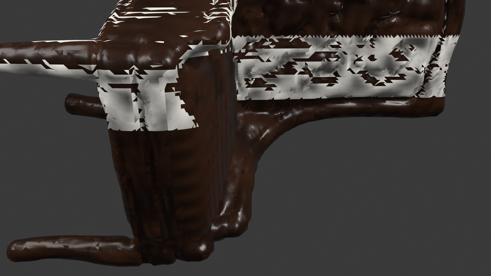
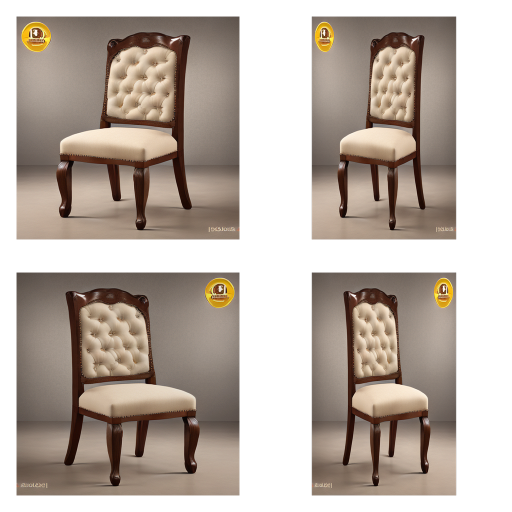
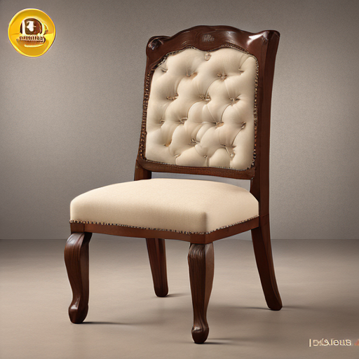
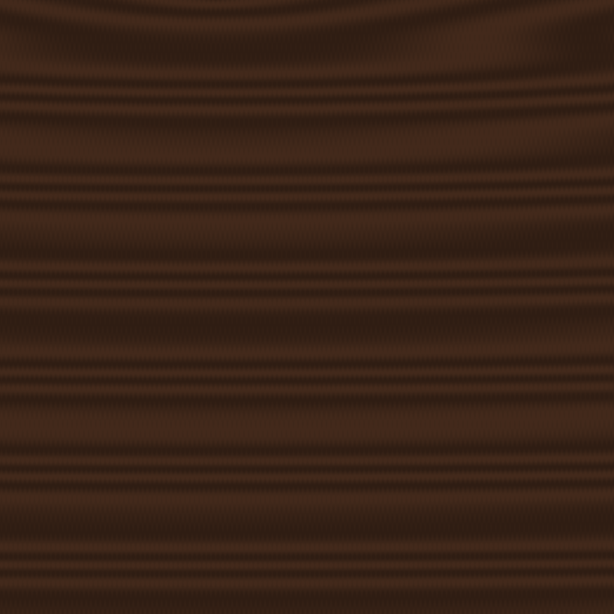
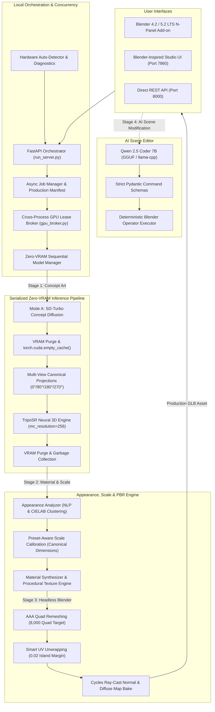

# Local Mesh AI 🚀
### Local-First Neural 3D Asset Generation & AI Technical Artist Studio

[](tests/)
[](LICENSE)
[](https://www.python.org/)
[](https://pytorch.org/)
[](https://www.blender.org/)
[](#-zero-vram-overlap--memory-broker)
[-orange.svg)](docs/presentation/Local_Mesh_AI_Project_Presentation.pptx)

---

### 🧭 Navigation & Deliverables
[**🚀 Phase 5 Blender Studio Report**](docs/PHASE_5_BLENDER_STUDIO_REPORT.md) • [**Phase 4 Delivery Report**](docs/PHASE_4_GENERATION_PIPELINE_REPORT.md) • [**📖 Beginner Guide**](BEGINNER_GUIDE.md) • [**📘 User Manual**](docs/USER_GUIDE.md) • [**🧩 Multi-Engine Architecture**](docs/MULTI_ENGINE_ARCHITECTURE.md) • [**📊 20-Case Benchmark**](docs/BENCHMARK_REPORT.md) • [**🛠️ Contributing**](CONTRIBUTING.md) • [**⚖️ Legal Audit**](docs/LEGAL_AND_LICENSE_AUDIT.md) • [**🛡️ Failure Recovery**](docs/FAILURE_RECOVERY_AUDIT.md) • [**📊 Presentation Deck (.pptx)**](docs/presentation/Local_Mesh_AI_Project_Presentation.pptx) • [**🎤 Presenter Notes**](docs/presentation/Presenter_Notes.md) • [**📋 Demo Checklist**](docs/presentation/Live_Demo_Checklist.md) • [**📈 Release Validation Report**](docs/presentation/Release_Validation_Report.md) • [**📜 License**](LICENSE)

---

## 🌟 Executive Overview

**Local Mesh AI** is an open-source, local-first 3D asset generation, inspection, and AI technical-art studio engineered for workstation and consumer NVIDIA GPUs. It produces watertight, multi-material, PBR-textured 3D models directly from pure text descriptions or 2D concept images with **zero cloud dependencies, zero subscription fees, and 100% local privacy**.

Featuring a serialized Zero-VRAM GPU lease broker, Local Mesh AI runs full neural reconstruction and high-fidelity texture baking seamlessly on **6 GB VRAM GPUs** (such as the RTX 3050 Laptop) up to multi-GPU workstations.

---

## 🎨 Genuine Production Output Showcase

Below is an authentic dining chair generated completely end-to-end via **Mode A: Text-to-3D** using the prompt:
> *"a dining chair with a dark walnut-brown wooden frame and legs, an ivory-cream fabric upholstered seat cushion, and a matching cream tufted backrest"*

| High-Fidelity EEVEE Viewport Render | 4-View Canonical Projections |
| :---: | :---: |
|  |  |
| *Blender 5.2 EEVEE render: Distinct dark walnut wood frame and ivory-cream tufted upholstery (52,552 vertices, 3 PBR material slots).* | *Canonical orthographic projections (0°, 90°, 180°, 270°) feeding the TripoSR neural reconstruction engine.* |

| 2D Diffusion Concept Artwork | Procedural PBR Diffuse Maps (Wood & Fabric) |
| :---: | :---: |
|  |  |
| *SD-Turbo 1-step concept synthesis on isolated studio background.* | *Authoritative 1024×1024 diffuse, normal, and roughness maps embedded in final GLB.* |

---

## 🌟 Core Capabilities

* **⚡ Dual-Mode 3D Generation:**
  * **Mode A (Text-to-3D):** Synthesizes crisp concept artwork via local SD-Turbo diffusion, projects canonical orthographic views, and reconstructs 3D geometry with automated appearance analysis.
  * **Mode B (Image-to-3D):** Direct upload of user concept art with **strict diffusion bypass**—reconstructing 3D geometry directly from source pixels.
* **🎨 Multi-Material PBR Shader Synthesis:**
  * Extracts distinct semantic material regions via NLP prompt analysis and CIELAB color clustering.
  * Authors dedicated Blender Principled BSDF material slots (`m_wood_frame`, `m_fabric_cushion`, `m_fabric_backrest`).
  * Generates 1024×1024 Diffuse, 16-bit Normal, and Roughness texture maps baked directly into the exported GLB.
* **📐 Preset-Aware Canonical Scale Calibration:**
  * Enforces real-world dimensional accuracy across asset classes:
    * **Furniture / Chairs:** `0.90 m` canonical height
    * **Weapons / Swords / Axes:** `1.00 m` canonical length
    * **Characters / Humanoids:** `1.80 m` canonical height
    * **Vehicles / Karts:** `1.50 m` canonical height
    * **Props / Items:** `0.80 m` canonical height
  * Eliminates oversized neural reconstructions while strictly preserving aspect ratios, UV coordinates, and vertex normals.
* **🛡️ Zero-VRAM Overlap & Memory Broker:**
  * Serializes model residency (`NONE` $\rightarrow$ `SD_TURBO` $\rightarrow$ `TRIPOSR` $\rightarrow$ `BLENDER`), purging VRAM to **0.0 MB** between stages.
  * Cross-process atomic file and thread leases eliminate Out-Of-Memory exceptions on 6GB–8GB GPUs.
* **🧠 AI Technical Artist (Qwen 2.5 Coder 7B):**
  * Natural language 3D scene editing (*"Make the frame polished brass metallic and bevel edges by 2mm"*).
  * Enforces strict Pydantic command schemas with **zero arbitrary code execution**.
* **🔌 Native Blender 4.2 / 5.2 LTS Add-on:**
  * Sidebar N-Panel extension with non-blocking async background timers (`bpy.app.timers`).
  * One-click terminal auto-launcher, isolated collection management (`AI_Generated_Assets`), and automatic viewport material preview.
* **📦 AAA Quad Retopology & UV Unwrapping:**
  * Automatic quad-dominant decimation targeting 8,000 polygons, smart UV unwrapping (0.02 island margin), and Cycles ray-cast normal/diffuse map baking.
* **🧩 Modular Multi-Engine AI 3D Generation Architecture:**
  * Dynamic hardware-adaptive router supporting TripoSR (feedforward baseline), OpenAI Shap-E (Strategy A direct text-to-3D), Hybrid SD-Turbo + TripoSR (Strategy B concept art to 3D), Stable Fast 3D, and Microsoft TRELLIS.
  * Rigorous hardware gating that prevents OOM crashes on consumer GPUs (RTX 3050 6GB) while unlocking heavy models on high-memory workstations.
* **🎨 Live Appearance Studio (Blender & Web UI):**
  * Real-time PBR material customization directly on active 3D meshes without regenerating neural geometry.
  * Built-in material presets (Walnut, Oak, Royal Velvet, Brushed Steel, Gold, Clean Plastic, Stone, Glazed Ceramic) with interactive Metallic, Roughness, Specular, and Color Tint sliders.
* **🛡️ Shared Geometry Quality, Validation & Finishing:**
  * Purges NaN/Inf coordinates, eliminates degenerate zero-area faces, enforces consistent outward normal winding, and diagnoses/repairs monochromatic "white-material" meshes.
* **🧠 Phase 3.1 & 3.1.1: Real AI Model Integration, Truthful Status Verification & Production Hardening:**
  * **Truthful 9-State Model Lifecycle & Verification Receipts:** Rigorous `ModelStatus` taxonomy (`MISSING`, `FOUND_UNVERIFIED`, `VERIFIED_OFFLINE`, `RUNTIME_READY`, `INFERENCE_VERIFIED`, `VERIFIED_ON_HARDWARE`, `DEPENDENCIES_MISSING`, `INCOMPATIBLE`, `FAILED`) backed by persistent receipt logs (`.model_verification_receipts.json`). Zero synthetic simulation—uninstalled weights (e.g., SD-Turbo) report honestly as `MISSING`.
  * **NVIDIA PartField Neural 3D Segmentation:** Continuous feature-field decomposition executing genuine PyTorch forward passes (839 MB peak VRAM, 7.2s latency) producing clean component boundary hierarchies without fake heuristics.
  * **Qwen3-VL Multimodal Visual Component Perception:** Direct camera render encoding via `mmproj` (324 ms encode latency, 3.2 GB VRAM) with true look-at camera coordinate rotations, depth-sorted polygon rasterization, component color masks, and strict candidate allowlisting to eliminate hallucinated components.
  * **Dynamic Qwen Coder Technical-Artist Brain:** Dynamic scaling for arbitrary percentages (e.g. 23%, 12.5%), direction keywords, action-invariant clause separation, and automatic invariant tracking for all non-target components.
  * **Hardened Cross-Process GPU Lease Broker:** Atomic file locking with PID ownership verification and an automatic background heartbeat daemon renewing every 60s for long-running neural segmentation and inference tasks.
  * **In-Place Topological Geometry Editing:** Precision in-place vertex manipulation on target component vertices (`result_mesh.vertices[target_v_indices] = ...`) strictly preserving face winding, UV maps, and non-target invariants (0.00% non-target deviation).
  * **Bounded Precision Safety Loop:** Detects ambiguous or non-existent component requests and halts safely (`NEEDS_COMPONENT_CONFIRMATION`), measures physical post-edit geometry dimensions, and automatically rolls back if non-target invariants deviate by >5%.
  * **Model Verification CLI:** Run `python scripts/verify_ai_models.py --vram`, `--json`, or `--smoke` to inspect local model presence, formats, licenses, and truthful operational readiness.

---

## 📥 Downloads & Release Bundles

Official packaged release archives are available under [**GitHub Releases**](https://github.com/Kernlab-001/local-mesh-ai/releases):

* 📦 **Production Release v5.0:** **`local-mesh-ai-v5.0.zip`** (49.5 MB)
  * **SHA-256 Checksum:** `63642280F0406615C409A740A0C50C6EEBC64C2D855890534A8D51AD2692ACD5`
  * Contains the full neural engine, canonical scale calibrator, batch runners, test suites, and the native Blender v5.0 add-on.
* 🔌 **Standalone Blender Add-on v5.0:** **`triposr_blender_addon_v5.0.zip`** (12 KB)
  * One-click direct installation archive for Blender 4.2 LTS / 5.2 LTS Preferences.

---

## 🏗️ System Architecture



---

## 🚀 Quickstart Guide

### 1. System Requirements
* **Operating System:** Windows 10/11 (64-bit), Linux (x86_64), or macOS.
* **Graphics Card (GPU):** NVIDIA GPU with 6GB+ VRAM (CUDA 12+) recommended; CPU inference mode supported for basic testing.
* **Blender:** Blender 4.2 LTS or Blender 5.2 LTS installed.
* **Python:** Python 3.10 – 3.12.

### 2. 1-Click Windows Setup (`launchers/` folder)

1. **Step 1 — Environment Setup:**
   Double-click [`launchers/1_setup_environment.bat`](launchers/1_setup_environment.bat).
   * Automatically initializes the `.venv` virtual environment and installs PyTorch CUDA 12.4, diffusers, trimesh, and requirements.
2. **Step 2 — Hardware Detection:**
   Double-click [`launchers/2_detect_hardware.bat`](launchers/2_detect_hardware.bat).
   * Probes GPU model, physical VRAM, CUDA capabilities, and auto-locates Blender executable.
3. **Step 3 — Launch 3D Studio Workstation:**
   Double-click [`launchers/5_start_studio_ui.bat`](launchers/5_start_studio_ui.bat).
   * Spawns the studio workspace at `http://127.0.0.1:7860`.

*(For Linux / macOS: `python3 -m venv .venv && source .venv/bin/activate && pip install -r requirements.txt && python3 detect_hardware.py`)*

---

## 🎨 Native Blender Add-on Setup

### Installation in Blender (4.2 LTS & 5.2 LTS)
1. Open **Blender 5.2** (or 4.2 LTS).
2. Go to **Edit > Preferences > Add-ons**.
3. In the upper-right corner, click **Dropdown Arrow (⌄) > Install from Disk...**
4. Select [`addon/triposr_blender_addon.py`](addon/triposr_blender_addon.py) and enable **Local Neural 3D Studio**.

### In-Blender Generation Workflow
1. In the 3D Viewport, press **`N`** to reveal the sidebar $\rightarrow$ select the **`AI 3D Generator`** tab.
2. **Server & Path Settings (One-time):** Expand the panel and ensure **Repo Root** points to your `local-mesh-ai` folder (persisted in preferences).
3. **⚡ Zero-Click Terminal Auto-Launcher:** Clicking **⚡ Generate 3D Asset** automatically verifies if the background server is running; if not, it launches the server terminal window automatically!
4. Choose **Prompt to 3D** or **Image to 3D**, enter your prompt or select an image, and click generate.
5. Assets stream directly into an isolated `AI_Generated_Assets` collection with fully wired PBR shaders, centered pivots, and authentic materials.

---

## 📊 Hardware Benchmarks & Performance Profiles

| Hardware Profile | Target GPUs / Hardware | VRAM / RAM | Quality Profile | Recommended Local LLM | Reconstruction | Total End-to-End |
| :--- | :--- | :--- | :--- | :--- | :--- | :--- |
| **Workstation / Enthusiast** | NVIDIA RTX 4090, 3090, RTX 6000 Ada, A5000 / A6000 | 24 GB – 48 GB | High (`res=384, chunk=4096`) | **Qwen 2.5 Coder 14B / 32B** | ~8–10s | **~12–15s** |
| **Pro / Performance** | NVIDIA RTX 4080, 4070 Ti Super, AMD RX 7900 XTX | 16 GB | High (`res=384, chunk=4096`) | **Qwen 2.5 Coder 14B** | ~10–12s | **~15–18s** |
| **Upper Mid-Range** | NVIDIA RTX 4070, 3080, 4060 Ti 16GB, AMD RX 7800 XT | 12 GB – 16 GB | Balanced (`res=256, chunk=8192`) | **Qwen 2.5 Coder 7B** | ~11–13s | **~18–22s** |
| **Mainstream Desktop** | NVIDIA RTX 4060, 3060 12GB, 2070 Super, Intel Arc A770 | 8 GB – 12 GB | Balanced (`res=256, chunk=8192`) | **Qwen 2.5 Coder 7B** | ~12–15s | **~20–24s** |
| **Entry-Level / Laptop** | NVIDIA RTX 3050 Laptop / Desktop (6GB), RTX 2060 (6GB) | 6 GB | Balanced (`res=256, chunk=8192`) | **Qwen 2.5 Coder 7B** | ~14–18s | **~28–32s** |
| **Budget / Handheld / Mac** | NVIDIA RTX 3050 (4GB), GTX 1650, Steam Deck, Apple M1/M2/M3 | 4 GB VRAM / Unified | Draft (`res=128, chunk=8192`) | **Qwen 2.5 Coder 3B / 1.5B** | ~10–12s | **~24–28s** |
| **CPU / Integrated Mode** | Intel Core i5/i7/i9 (12th–14th Gen), AMD Ryzen 5/7/9 (AVX2) | 16 GB+ System RAM | Draft (`res=128, chunk=8192`) | **Qwen 2.5 Coder 1.5B** | ~40–55s | **~60–75s** |

---

## 🧠 Local AI Models & Hardware Compatibility

Local Mesh AI is built on a **modular multi-model specialist architecture** that loads specialized neural models sequentially to guarantee zero Out-Of-Memory (OOM) crashes on consumer hardware. Only the model required for the active inference stage resides in GPU memory; VRAM is purged to 0.0 MB between stages.

The system automatically detects your host GPU and system RAM to configure an optimal model stack. The primary tested baseline is the **NVIDIA GeForce RTX 3050 6GB Laptop GPU (with 16GB RAM and Windows 11)**.

### Recommended Local Model Stack by Task

| Task | Recommended Model | Alternative / Fallback | VRAM Req. | Execution Mode |
| :--- | :--- | :--- | :--- | :--- |
| **3D Part Segmentation** | **PartField (NVIDIA)** | **Geometric Feature Fields** | 0.0 – 4.5 GB | Isolated Worker / Native CPU |
| **Semantic Part Labeling** | **Qwen3-VL-4B-Instruct GGUF** | **Qwen2.5-VL-3B-Instruct GGUF** | 2.8 – 3.8 GB | Sequential GPU (cuBLAS) |
| **Technical-Artist Planner** | **Qwen 2.5 Coder 7B GGUF** | **Qwen 2.5 Coder 1.5B GGUF** | 4.0 – 4.5 GB | Sequential GPU (cuBLAS) |
| **Text-to-Image Concept** | **SD-Turbo (1-Step)** | **None** | 3.2 – 3.5 GB | Sequential GPU (CUDA) |
| **Image-to-3D Neural Mesh** | **TripoSR (Watertight NeRF)** | **Stable Fast 3D (8GB+)** | 3.0 – 3.2 GB | Sequential GPU (CUDA) |
| **Procedural PBR Materials** | **Blender Cycles/EEVEE Engine** | **None (No AI Needed)** | 0.0 GB | Headless Blender (CPU/GPU) |
| **Exact Dimension & Alignment**| **CPU Geometry Engine** | **None (No AI Needed)** | 0.0 GB | Deterministic NumPy / Trimesh |
| **Geometry Construction & Editing**| **Blender BMesh API** | **Trimesh Parametric** | 0.0 GB | Headless Blender 5.2 |

👉 **For exhaustive hardware tier configurations (4GB, 6GB, 8GB, 12GB, 16GB, 24GB+), exact download references, benchmark telemetry, and installation instructions, see the complete guide:**  
[**📖 Local AI Model Selection & Hardware Orchestration Guide**](docs/LOCAL_AI_MODEL_SELECTION_GUIDE.md)

---

---

## 🎨 Phase 5: Blender Studio Integration & Interactive 3D Workspace

Phase 5 delivers an interactive, native Blender workspace extension connecting Local Mesh AI's generation pipeline directly to professional artists:

### 1. Dedicated `LOCAL MESH AI` Sidebar Tab
Located in the 3D Viewport Sidebar (`N-Panel` > `LOCAL MESH AI`), organized into 7 structured panels:
1. **Connection & Health (`LOCALMESH_PT_Connection`):** Real-time server health ping, latency tracking, GPU telemetry, VRAM utilization, one-click backend console launcher, and API dashboard launcher.
2. **Generate AI 3D Asset (`LOCALMESH_PT_Generate`):** Dual-mode inputs (Text-to-3D prompt & Image-to-3D reference upload with image staging), dynamic route selection (`text_to_3d_pipeline`, `text_to_3d_direct`, `image_to_3d_triposr`), hardware profiles (`low_memory`, `balanced`, `quality`), architectural presets (weapons, props, characters, furniture, vehicles), and material toggles.
3. **Job Monitor (`LOCALMESH_PT_JobMonitor`):** Thread-safe background polling via `bpy.app.timers`. Displays live progress percentages, stages, elapsed seconds, job cancellation control, and automatic main-thread mesh import into `AI_Generated_Assets`.
4. **Generated Assets Catalogue (`LOCALMESH_PT_Assets`):** Local and backend asset browser, file size telemetry, one-click scene import, and output folder launcher.
5. **Scene Information (`LOCALMESH_PT_SceneInfo`):** Live scene asset metrics (total objects, lights, cameras) and active mesh geometry inspection (vertices, polygon count, real-world metric dimensions X/Y/Z, material slots).
6. **Two-Way Scene Synchronization (`LOCALMESH_PT_SceneSync`):** Pushes active and scene mesh hierarchies to `/api/v1/blender/sync-scene`, pulls backend registered scene status, and tracks synchronization timestamps.
7. **Interactive Mesh Controls (`LOCALMESH_PT_MeshControls`):** One-click geometric transforms (snap to ground Z=0, center pivot to origin, uniform scale to target height), normal recalculation, degenerate geometry cleanup, and retained Phase 3 component precision editing.

### 2. Standard Installation Guide
* **Method A (ZIP Package):** In Blender, open `Edit` > `Preferences` > `Add-ons` > `Install...`, select `dist/local_mesh_ai_blender_addon.zip`, and enable the checkbox.
* **Method B (Direct Script):** Place `addon/triposr_blender_addon.py` into your Blender scripts folder (`%APPDATA%\Blender Foundation\Blender\<version>\scripts\addons\`).

---

## 🧪 Automated Testing & Verification

The test suite covers API routing, multi-material shader synthesis, color calibration math, GPU concurrency leasing, geometry sanitization, and UI event binding:

```bash
# Windows
launchers\4_run_tests.bat

# Linux / macOS
pytest tests -v
```

### Test Suite Execution Summary
* **Total Tests Collected:** 85
* **Passed:** 85 (100% pass rate)
* **Failed:** 0
* **Skipped:** 0

| Test Module | Tests | Description |
| :--- | :---: | :--- |
| `tests/test_api.py` | 11 | REST endpoints, health check, job status polling |
| `tests/test_color_and_materials.py` | 12 | PBR material slots, texture generation, UV unwrap, GLB appearance |
| `tests/test_color_calibrator.py` | 2 | Perceptual $L^*a^*b^*$ Reinhard color distribution math |
| `tests/test_command_schemas.py` | 4 | Strict Pydantic command schemas for AI scene edits |
| `tests/test_dependency_verification.py` | 6 | PyTorch 2.6.0+cu124, torchvision, CUDA driver readiness |
| `tests/test_dual_mode_pipeline.py` | 4 | Mode A (Text-to-3D) and Mode B (Image-to-3D bypass) lifecycle |
| `tests/test_failure_recovery.py` | 6 | Stale lock reclamation, CUDA OOM cleanup, Blender fallback, corrupt image rejection |
| `tests/test_gpu_broker.py` | 4 | Cross-process atomic GPU locks and concurrency serialization |
| `tests/test_hardware_detector.py` | 4 | GPU VRAM profiling, CUDA capability check, Blender path resolution |
| `tests/test_image_validation.py` | 3 | Aspect ratio, alpha transparency, and image format sanitization |
| `tests/test_job_lifecycle.py` | 3 | Asynchronous queue state progression and cancel handling |
| `tests/test_mesh_serving_and_viewer.py` | 5 | glTF/GLB MIME types, Three.js viewer embedding, error states |
| `tests/test_onboarding_and_diagnostics.py` | 7 | First-launch tour, environment checks, diagnostic reports |
| `tests/test_production_pipeline.py` | 3 | End-to-end multi-view synthesis and decimation |
| `tests/test_prompt_engine.py` | 2 | 77-token CLIP sequence management and SD-Turbo prompt cleaning |
| `tests/test_ui_dashboard.py` | 9 | Blender design system tokens, wireframe toggles, preset auto-calibration |

---

## 📁 Repository Structure

```text
local-mesh-ai/
├── BEGINNER_GUIDE.md           # Beginner guide, step-by-step tutorial & 3D glossary
├── CONTRIBUTING.md             # Developer setup, coding standards, and PR guide
├── LICENSE                     # Apache 2.0 Open Source License
├── config.example.json         # Reference configuration template
├── detect_hardware.py          # Dynamic GPU & environment auto-detection
├── run_server.py               # Starts FastAPI local orchestration backend (Port 8000)
├── run_master.py               # Master CLI orchestration runner
├── requirements.txt            # Python dependencies
│
├── docs/                       # Official documentation & presentation assets
│   ├── USER_GUIDE.md           # Comprehensive operations manual
│   ├── LEGAL_AND_LICENSE_AUDIT.md # Comprehensive legal & third-party license audit
│   ├── FAILURE_RECOVERY_AUDIT.md  # Failure-recovery and hardware resilience audit
│   ├── assets/                 # High-resolution genuine renders and textures
│   │   ├── chair_render_eevee.png
│   │   ├── multiview_grid.png
│   │   ├── concept_art_chair.png
│   │   ├── tex_wood_diffuse.png
│   │   └── tex_fabric_diffuse.png
│   └── presentation/           # Technical presentation deliverables
│       ├── Local_Mesh_AI_Project_Presentation.pptx  # 12-slide widescreen deck (5.0 MB)
│       ├── Presenter_Notes.md                       # Verbatim presentation script
│       ├── Live_Demo_Checklist.md                   # 7-step fail-safe live demo guide
│       ├── Project_Facts.md                         # Authoritative technical facts ledger
│       ├── Release_Validation_Report.md             # Senior QA validation audit
│       └── Release_Demo_Results.md                  # Measured runtime telemetry
│
├── launchers/                  # 1-Click numbered Windows batch runners
│   ├── 1_setup_environment.bat # Creates .venv & installs all dependencies
│   ├── 2_detect_hardware.bat   # Auto-detects GPU, VRAM & Blender path
│   ├── 3_start_backend.bat     # Launches local orchestration server
│   ├── 4_run_tests.bat         # Runs 85 automated test suites
│   └── 5_start_studio_ui.bat   # Launches Blender-inspired 3D Studio workstation
│
├── core/
│   ├── appearance_analyzer.py  # NLP material extraction & CIELAB color clustering
│   ├── material_synthesizer.py # Smart UV unwrapping & polygon slot partitioning
│   ├── texture_generator.py    # Procedural 1024x1024 diffuse, normal, & roughness maps
│   ├── prompt_to_image.py      # Real-time concept image synthesis (SD-Turbo)
│   ├── triposr_engine.py       # Validated TripoSR neural reconstruction manager
│   ├── color_calibrator.py     # Perceptual Lab Reinhard color transfer engine
│   ├── multiview_synthesizer.py# Canonical 4-view projection & 2x2 grid engine
│   ├── geometry_sanitizer.py   # Preset-aware canonical scaling & mesh repair
│   ├── gpu_broker.py           # Cross-process GPU lease broker (atomic lock)
│   ├── model_lifecycle.py      # Zero-VRAM sequential model manager
│   ├── qwen_planner.py         # Qwen 2.5 Coder natural language planner
│   ├── command_schemas.py      # Strict Pydantic command schemas (zero arbitrary code)
│   └── blender_executor.py     # Deterministic Blender Python executor
│
├── bridge/
│   ├── blender_bridge.py       # Headless Blender scene integration & scale calibration
│   └── retopology_and_baker.py # AAA quad remeshing, UV unwrap & Cycles ray baking
│
├── api/
│   ├── app.py                  # FastAPI application definition
│   ├── routes.py               # /health, /jobs, /jobs/{id}, /edit, /export
│   └── schemas.py              # Pydantic request & response schemas
│
├── services/
│   ├── job_manager.py          # Async job queue, timing metrics & manifest writer
│   └── export_service.py       # GLB, FBX, OBJ export pipeline (with timeouts)
│
├── addon/
│   └── triposr_blender_addon.py # Native Blender 4.2 / 5.2 N-Panel extension (GPLv3)
│
├── ui/
│   └── dashboard.py            # Blender-inspired dark 3D Studio workstation (Port 7860)
│
└── tests/                      # 85 unit, integration, and UI test suites
```

---

## 📜 License & Model Attributions

* **Application Code:** Distributed under the **Apache 2.0 License**. See [`LICENSE`](LICENSE).
* **Blender Add-on:** Distributed under the **GNU General Public License v3.0 (GPLv3)** in compliance with Blender Python API licensing. See [`addon/triposr_blender_addon.py`](addon/triposr_blender_addon.py).
* **TripoSR:** Neural 3D reconstruction engine and weights licensed under the **MIT License** by VAST-AI Research & Stability AI.
* **SD-Turbo:** 1-step concept synthesis model distributed under the **Stability AI Non-Commercial Research Community License** (research/non-commercial use only; commercial deployment requires a commercial license from Stability AI).
* **Qwen 2.5 Coder:** LLM planning weights released by Alibaba Cloud under the **Apache 2.0 License**.
* **Commercial Deployment Guidance:** Mode B (Image-to-3D) uses entirely permissive components (MIT / Apache / GPL) and is commercially usable. Mode A (Text-to-3D) is encumbered by SD-Turbo's non-commercial research terms. For full details, see the [`Legal & License Audit`](docs/LEGAL_AND_LICENSE_AUDIT.md).
