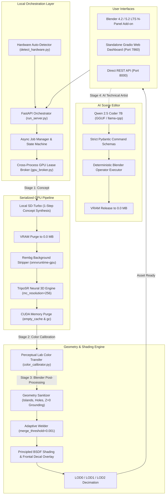

# Local Mesh AI 🚀
### Local-First Neural 3D Asset Generation & AI Technical Artist Studio

[](LICENSE)
[](https://www.python.org/)
[](https://pytorch.org/)
[](https://www.blender.org/)
[](tests/)

**Local Mesh AI** is an open-source, local-first 3D asset generation, inspection, and editing suite designed for local consumer and workstation GPUs. Generate watertight, color-accurate, PBR-textured 3D models directly from pure text prompts or reference images with **zero cloud dependencies** and **zero subscription fees**.

---

## 🌟 Key Features

* **⚡ Text-to-3D & Image-to-3D:** Generate complete 3D assets from text prompts (*"medieval glowing battleaxe"*, *"cyberpunk power crate"*) or upload any 2D concept art.
* **🎨 Accurate Color Calibration (Tripo AI Style):** Uses statistical perceptual $L^*a^*b^*$ color distribution transfer to match the 3D model's palette 1:1 with source artwork, eliminating muddy or desaturated textures.
* **🧠 AI Technical Artist (Qwen 2.5 Coder 7B):** Edit 3D scenes using natural language (*"Make it shiny gold metallic and bevel edges by 2mm"*). Powered by a deterministic, schema-validated command allowlist with **zero arbitrary code execution**.
* **🔌 Native Blender 5.2 / 4.2 LTS Add-on:** N-Panel extension with non-blocking background polling (`bpy.app.timers`), automatic viewport material preview, and isolated collection management.
* **🖥️ Standalone Dual-Pane Dashboard:** Interactive Gradio interface featuring real-time Three.js 3D solid/wireframe viewport and 360° turntable video rendering.
* **🛡️ Dynamic Hardware Auto-Detection & VRAM Broker:** Scans host GPU and VRAM capacity on startup, auto-tuning marching cubes resolution and chunk size. Serializes GPU tasks across processes via atomic file locking to prevent Out-Of-Memory crashes on 6GB–8GB GPUs.
* **📦 Multi-Format Export:** 1-Click export to **GLB**, **FBX**, and **OBJ** with LOD generation (LOD0, LOD1, LOD2).

---

## 📥 Downloads & Releases

Get the latest release bundle directly from [**GitHub Releases**](https://github.com/Kernlab-001/local-mesh-ai/releases/latest):

* 📦 **Complete Project Archive:** [**`local-mesh-ai-v2.1.zip`**](https://github.com/Kernlab-001/local-mesh-ai/releases/latest) — All-in-one release package containing the full neural engine, hardware calibrator, batch runners, and the native Blender add-on.

---

## 🏗️ System Architecture



---

## 🚀 Quickstart Guide

### 1. Prerequisites
* **Operating System:** Windows 10/11, Linux, or macOS.
* **GPU:** NVIDIA GPU with 4GB+ VRAM (CUDA 12+) recommended; CPU mode supported for basic testing.
* **Blender:** Blender 4.2 LTS or Blender 5.2 LTS installed.
* **Python:** Python 3.10 – 3.12.

### 2. Installation
Clone the repository:
```bash
git clone https://github.com/Kernlab-001/local-mesh-ai.git
cd local-mesh-ai
```

Install dependencies into a virtual environment:
```bash
python -m venv .venv
# Windows
.venv\Scripts\activate
# Linux/macOS
source .venv/bin/activate

pip install -r requirements.txt
```

### 3. Run Hardware Auto-Detection
Double-click [`detect_hardware.bat`](detect_hardware.bat) or run:
```bash
python detect_hardware.py
```
This automatically detects your installed GPU, physical VRAM, and Blender path, calibrating `config.json` for your specific machine.

---

## 🎨 Using the Blender Add-on

### Installation in Blender
1. Open **Blender 5.2** (or 4.2 LTS).
2. Go to **Edit > Preferences > Add-ons**.
3. In the top-right corner, click **Dropdown Arrow (⌄) > Install from Disk...**
4. Select [`addon/triposr_blender_addon.py`](addon/triposr_blender_addon.py).
5. Check the box to enable **Local Neural 3D Studio**.

### Generating Assets in Blender
1. In Blender's 3D Viewport, press **`N`** to reveal the sidebar $\rightarrow$ click the **`AI 3D Generator`** tab.
2. **Configure Repo Root (One-time):** Expand **Server & Path Settings** and ensure **Repo Root** points to your extracted `local-mesh-ai` folder (this is saved permanently to your global Blender Add-on Preferences).
3. **⚡ Zero-Click Terminal Auto-Launcher:** You don't need to manually start a terminal window before working. When you click **⚡ Generate 3D Asset**, Blender automatically checks if the backend server is running; if not, it automatically spawns the server terminal console in a separate window, initializes the GPU pipeline, and submits your generation!
4. Alternatively, you can click **`Launch Terminal`** in the status header at the top of the N-Panel at any time to open the console and inspect live GPU memory logs.
5. Choose your generation mode:
   * **Prompt to 3D:** Enter any descriptive prompt (*e.g., "medieval glowing battleaxe with carved runes"*) $\rightarrow$ Click **⚡ Generate 3D from Prompt**.
   * **Image to 3D:** Pick any 2D reference artwork $\rightarrow$ Click **⚡ Generate 3D from Image**.
6. The asset generates with live non-blocking progress updates and imports automatically into an isolated collection (`AI_Generated_Assets`) with full PBR shaders, centered pivot, and perceptually calibrated colors matching reference artwork vibrancy.

---

## ⚡ Local Orchestration Server & REST API

The local server orchestrates all AI model loading, cross-process GPU leasing, and geometry processing over a high-performance REST API on port `8000`.

To start the server manually (optional):
```bash
# Windows
start_api.bat
# or
python run_server.py
```

* **Interactive API Documentation:** Available at `http://127.0.0.1:8000/docs` (Swagger UI).
* **Endpoints:**
  * `POST /jobs`: Queue a Prompt-to-3D or Image-to-3D generation task.
  * `GET /jobs/{id}`: Poll non-blocking progress, stage, and memory status.
  * `POST /edit`: Execute natural-language scene modifications via Qwen 2.5 Coder.
  * `POST /export`: Export any scene asset to GLB, FBX, or OBJ.
  * `GET /health`: GPU status, active leases, and VRAM telemetry.

---

## 📊 Benchmark Performance Across Hardware Tiers

| Hardware Profile | Target GPUs / Processors | VRAM / RAM | Quality Profile | Recommended Local LLM Model (GGUF) | Reconstruction | Total End-to-End |
| :--- | :--- | :--- | :--- | :--- | :--- | :--- |
| **Workstation / Enthusiast** | NVIDIA RTX 4090, 3090, RTX 6000 Ada, A5000 / A6000 | 24 GB – 48 GB | High (`res=256, chunk=4096`) | **Qwen 2.5 Coder 14B / 32B Instruct** (`Q4_K_M`) | ~8–10s | **~12–15s** |
| **Pro / Performance** | NVIDIA RTX 4080, 4070 Ti Super, AMD Radeon RX 7900 XTX / 7900 XT | 16 GB | High (`res=256, chunk=4096`) | **Qwen 2.5 Coder 14B Instruct** (`Q4_K_M`) | ~10–12s | **~15–18s** |
| **Upper Mid-Range** | NVIDIA RTX 4070, 4070 Super, 3080, 4060 Ti 16GB, AMD RX 7800 XT | 12 GB – 16 GB | Balanced (`res=256, chunk=8192`) | **Qwen 2.5 Coder 7B Instruct** (`Q5_K_M`) | ~11–13s | **~18–22s** |
| **Mainstream Desktop** | NVIDIA RTX 4060, 3060 12GB, 2070 Super, 2080, AMD RX 7600 XT, Intel Arc A770 | 8 GB – 12 GB | Balanced (`res=256, chunk=8192`) | **Qwen 2.5 Coder 7B Instruct** (`Q4_K_M`) | ~12–15s | **~20–24s** |
| **Entry-Level / Laptop** | NVIDIA RTX 3050 Laptop / Desktop (6GB), RTX 2060 (6GB), GTX 1660 Ti | 6 GB | Balanced (`res=256, chunk=8192`) | **Qwen 2.5 Coder 7B** (`Q4_K_M`) or **3B** (`Q5_K_M`) | ~14–18s | **~28–32s** |
| **Budget / Handheld / Mac** | NVIDIA RTX 3050 (4GB), GTX 1650, Steam Deck, ROG Ally, Apple M1/M2/M3 | 4 GB VRAM / Unified | Draft (`res=128, chunk=8192`) | **Qwen 2.5 Coder 3B / 1.5B Instruct** (`Q4_K_M`) | ~10–12s | **~24–28s** |
| **CPU / Integrated Mode** | Intel Core i5/i7/i9 (12th–14th Gen), AMD Ryzen 5/7/9 (AVX2 mode) | 16 GB+ System RAM | Draft (`res=128, chunk=8192`) | **Qwen 2.5 Coder 1.5B Instruct** (`Q4_K_M`) | ~40–55s | **~60–75s** |

*All profiles enforce cross-process GPU leasing, purges VRAM to **0.0 MB** between stages to eliminate Out-Of-Memory exceptions.*

---

### 🧠 Local LLM Model Compatibility & Download Guide

Local Mesh AI utilizes local GGUF models for its natural-language AI Technical Artist scene editing. Select the model that matches your GPU VRAM tier:

| Model Tier | Model Name & Quantization | Size | Recommended GPU VRAM | Direct Download Link |
| :--- | :--- | :--- | :--- | :--- |
| **Lightweight (CPU / 4GB)** | `Qwen2.5-Coder-1.5B-Instruct-Q4_K_M.gguf` | ~1.1 GB | 4 GB VRAM or CPU | [HuggingFace 1.5B GGUF](https://huggingface.co/Qwen/Qwen2.5-Coder-1.5B-Instruct-GGUF) |
| **Compact (4GB – 6GB)** | `Qwen2.5-Coder-3B-Instruct-Q4_K_M.gguf` | ~2.1 GB | 4 GB – 6 GB VRAM | [HuggingFace 3B GGUF](https://huggingface.co/Qwen/Qwen2.5-Coder-3B-Instruct-GGUF) |
| **Standard (6GB – 12GB)** *(Default)* | `qwen2.5-coder-7b-instruct-q4_k_m.gguf` | ~4.3 GB | 6 GB – 12 GB VRAM | [HuggingFace 7B GGUF](https://huggingface.co/Qwen/Qwen2.5-Coder-7B-Instruct-GGUF) |
| **Pro (16GB – 24GB+)** | `Qwen2.5-Coder-14B-Instruct-Q4_K_M.gguf` | ~8.9 GB | 16 GB+ VRAM | [HuggingFace 14B GGUF](https://huggingface.co/Qwen/Qwen2.5-Coder-14B-Instruct-GGUF) |

> [!TIP]
> **Automatic Calibration:** Run `detect_hardware.bat` to automatically scan your GPU and print the ideal LLM tier for your system! Place any downloaded `.gguf` model in the root project folder and configure `"qwen_model_path"` in `config.json`.


---

## 🧪 Automated Testing

Local Mesh AI includes an automated test suite verifying GPU broker locks, command schemas, prompt generation, color transfer mathematics, and REST endpoints:
```bash
# Windows
run_tests.bat
# Linux/macOS
pytest tests -v
```
**25 / 25 test cases passing.**

---

## 📁 Repository Structure

```text
local-mesh-ai/
├── config.example.json         # Reference configuration template
├── detect_hardware.py          # Dynamic GPU & environment auto-detection
├── detect_hardware.bat         # 1-Click hardware scanner launcher
├── run_server.py               # Starts FastAPI local orchestration backend (Port 8000)
├── start_api.bat               # Windows launcher for API
├── run_tests.bat               # Windows launcher for automated test suite
├── requirements.txt            # Python dependencies
│
├── core/
│   ├── hardware_detector.py    # Auto-detects GPU, VRAM limits & Blender executable
│   ├── gpu_broker.py           # Cross-process GPU lease broker (atomic lock)
│   ├── prompt_to_image.py      # Real-time concept image synthesis (SD-Turbo)
│   ├── color_calibrator.py     # Perceptual Lab Reinhard color transfer engine
│   ├── triposr_engine.py       # Validated TripoSR neural reconstruction manager
│   ├── qwen_planner.py         # Qwen 2.5 Coder natural language planner
│   ├── command_schemas.py      # Strict Pydantic command schemas (zero arbitrary code)
│   ├── blender_executor.py     # Deterministic Blender Python executor
│   ├── geometry_sanitizer.py   # Floating island removal, hole capper, Z=0 grounder
│   ├── adaptive_weld_enhancer.py # Micro-gap sealer (Blender 4.2 / 5.2 compatible)
│   ├── uv_projection_overlay.py # Camera projection decal overlay & Principled BSDF setup
│   └── auto_rig_and_lods.py    # LOD generator (LOD0, LOD1, LOD2) & Rigify metarig
│
├── api/
│   ├── app.py                  # FastAPI application definition
│   ├── routes.py               # /health, /jobs, /jobs/{id}, /edit, /export
│   └── schemas.py              # Pydantic request & response schemas
│
├── services/
│   ├── job_manager.py          # Async job queue & worker state machine
│   └── export_service.py       # GLB, FBX, OBJ export pipeline
│
├── addon/
│   └── triposr_blender_addon.py # Native Blender 4.2 / 5.2 N-Panel extension (with auto-launcher)
│
├── release/                    # Pre-packaged distribution archives
│   └── local-mesh-ai-v2.1.zip  # Ready-to-run GitHub Release archive
│
└── tests/                      # 25 unit and integration tests
```

---

## 📜 License & Model Attributions

* **Application Code:** Distributed under the **Apache 2.0 License**. See [`LICENSE`](LICENSE).
* **TripoSR:** Neural 3D reconstruction engine licensed under the **MIT License** by VAST-AI Research & Stability AI.
* **SD-Turbo:** 1-step concept synthesis model distributed under the **Stability AI Community License** (research/non-commercial; commercial use requires a Stability AI license).
* **Qwen 2.5 Coder:** LLM planning weights licensed under the **Tongyi Qianwen License Agreement**.
