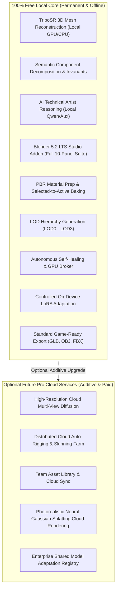

# Local Mesh AI — Product Architecture & Freemium Roadmap

**Status:** Strategic Architecture Proposal  
**Classification:** Product Planning & Monetization Guardrails  
**Repository:** https://github.com/Kernlab-001/local-mesh-ai  

---

## 1. Core Product Philosophy: Local-First Open Sovereignty

Local Mesh AI is founded on the conviction that essential 3D creation and generative AI tools must operate locally on user-owned hardware without recurring mandatory subscriptions, usage metering, forced telemetry, or artificial compute caps.

### The Immutable Local Guarantee:
- The **Local Core is 100% free, open-source, and offline-capable forever**.
- No features that run on local workstation hardware (GPU/CPU) will ever be paywalled, time-bombed, or artificially throttled.
- No mandatory accounts, registrations, or online DRM activations will ever be imposed on the local engine.

---

## 2. Capability Tier Breakdown: Free Local Core vs. Optional Pro Cloud

### Detailed Feature Comparison:

| Capability | Free Local Core (Standard) | Future Optional Pro Cloud Tier |
|---|---|---|
| **Cost** | **$0.00 (Free & Open Source)** | Subscription or Usage-based credits |
| **Execution Environment** | Local Workstation Hardware (RTX 3050+) | Scalable Cloud GPU Clusters (A100/H100) |
| **Internet Required?** | **No (100% Offline Capable)** | Yes (for cloud processing only) |
| **Account Required?** | **No** | Yes (API Key / Cloud Profile) |
| **Image-to-3D Generation** | Unlimited Local Inference (TripoSR) | Ultra-HD Multi-View Cloud Diffusion |
| **Mesh Editing & Technical Artist** | Full Component Edit Plans & Invariants | Shared Studio Team Rule Templates |
| **Texture Baking** | High-Res Blender Cycles Baking (Up to 4K) | Distributed 8K PBR Synthesis |
| **LoRA Adaptation** | On-Device Controlled PyTorch Adapters | Distributed Multi-User Model Adaptation |
| **Export Formats** | GLB, OBJ, FBX with LOD sets | GLB, OBJ, FBX, USDZ, Unreal/Unity Packages |
| **Asset Privacy** | 100% Private on Local Disk | Encrypted Transit, Zero Data Retention Storage |

---

## 3. Strict Monetization Guardrails

To protect user trust and community goodwill, any future commercialization must adhere to these non-negotiable rules:
1. **Never Degrade the Local Experience:** The introduction of cloud features must never reduce the performance, resolution, or functionality of the local engine.
2. **Local Hardware Belongs to the User:** If a machine has the GPU compute to perform an operation (such as local training or baking), Local Mesh AI will always allow it without fees.
3. **Additive-Only Value Proposition:** Cloud features will be introduced solely where local consumer hardware faces physical constraints (e.g. multi-view diffusion requiring 24+ GB VRAM or heavy distributed batch processing).
4. **Transparent Billing:** Any cloud compute will offer pay-as-you-go transparency with explicit usage confirmation, never hidden auto-renewals.
