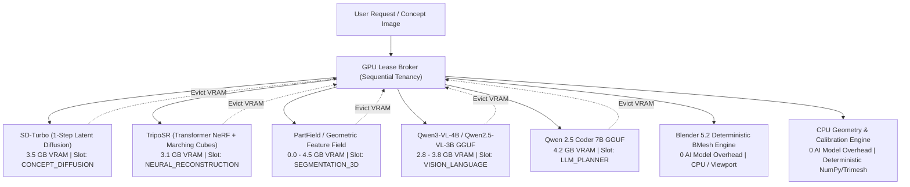

# Local AI Model Selection & Hardware Orchestration Guide

**Project:** Local Mesh AI  
**Author:** AI Systems Architect & Machine-Learning Integration Team  
**Hardware Baseline:** NVIDIA GeForce RTX 3050 6GB Laptop GPU | Intel Core i5-13420H | 16 GB DDR5 RAM | Windows 11  
**Scope:** Fully local-first AI 3D asset generation, component decomposition, precision alignment, and geometry editing without cloud API dependencies.

---

## 1. Project Model Architecture

Local Mesh AI is built on a **modular multi-model specialist architecture** rather than attempting to force a single monolithic large language model to perform visual, spatial, volumetric, and geometric tasks. 



### The Zero-VRAM Overlap Guarantee
On consumer systems with 6GB–8GB VRAM, running multiple neural models simultaneously inevitably triggers CUDA Out-Of-Memory (OOM) fatal crashes. Local Mesh AI enforces **strict single-model GPU occupancy**:
1. Before loading any neural model, the active model is evicted from VRAM via `core/model_lifecycle.py`.
2. PyTorch CUDA cache is purged via `torch.cuda.empty_cache()` and synchronized with `torch.cuda.synchronize()`.
3. The atomic cross-process lock (`core/gpu_broker.py`) acquires exclusive GPU hardware access.
4. If an optional specialist model exceeds available memory headroom, the system gracefully falls back to deterministic CPU routines without crashing.

---

## 2. Best Local AI Model per Task

| Task | Recommended Model | Alternative / Fallback | Quantization | Min VRAM | Min System RAM | Quality / Purpose | Hardware Status |
| :--- | :--- | :--- | :--- | :--- | :--- | :--- | :--- |
| **3D Part Segmentation** | **PartField (NVIDIA)** | **Geometric Feature Fields** | N/A (Triplane) | 4.0 GB | 16.0 GB | Open-world 3D feature-field part decomposition | `ESTIMATED — NOT TESTED` |
| **Semantic Part Labeling** | **Qwen3-VL-4B-Instruct** | **Qwen2.5-VL-3B-Instruct** | Q4_K_M + mmproj | 3.5 GB | 12.0 GB | Multi-view visual evidence interpretation | `ESTIMATED — NOT TESTED` |
| **Technical-Artist Planner** | **Qwen 2.5 Coder 7B** | **Qwen 2.5 Coder 1.5B** | Q5_K_M / Q4_K_M | 4.0 GB | 12.0 GB | Code, structure, hierarchy & tool sequencing | `VERIFIED ON HARDWARE` |
| **Text-to-Image Concept** | **SD-Turbo** | **None** | FP16 | 3.2 GB | 8.0 GB | 1-step real-time concept generation (0.8s) | `VERIFIED ON HARDWARE` |
| **Image-to-3D Neural Mesh** | **TripoSR** | **Stable Fast 3D (8GB+)** | FP16 | 3.0 GB | 16.0 GB | Watertight genus-0 feedforward synthesis | `VERIFIED ON HARDWARE` |
| **Procedural PBR Materials** | **Blender Cycles/EEVEE** | **None (No AI Needed)** | Deterministic | 0.0 GB | 8.0 GB | Principled BSDF & procedural texture baking | `NOT APPLICABLE (DETERMINISTIC)` |
| **Exact Dimension & Align** | **CPU Geometry Engine** | **None (No AI Needed)** | Deterministic | 0.0 GB | 8.0 GB | Exact metric extents, grounding, symmetry | `NOT APPLICABLE (DETERMINISTIC)` |
| **Geometry Construction** | **Blender BMesh API** | **Trimesh Parametric** | Deterministic | 0.0 GB | 8.0 GB | Primitives, bevel, boolean, extrusion | `NOT APPLICABLE (DETERMINISTIC)` |

> [!NOTE]
> AI is strictly prohibited from replacing exact mathematical geometry measurements or deterministic Blender modifiers. AI plans and sequences operations; mathematically reliable software executes them.

---

## 3. GPU Memory Profiles

Available VRAM directly dictates which models can be accommodated:

### 4 GB VRAM Tier
- **Strategy:** Ultra-compact models, heavy CPU offloading, strict sequential execution.
- **Recommended Stack:**
  - Image-to-3D: TripoSR (chunk size 4096, resolution 128)
  - Planner: Qwen 2.5 Coder 1.5B (Q4_K_M)
  - Vision: Qwen2.5-VL-3B (Q4_K_M with CPU layer offload)
  - Segmentation: Deterministic Geometric Feature Fields (0 VRAM)

### 6 GB VRAM Tier (Primary Baseline: RTX 3050 Laptop)
- **Strategy:** Compact quantized models, aggressive sequential loading, cuBLAS offloading.
- **Usable VRAM Budget:** ~4.2 GB (reserving 1.8 GB for Windows 11 DWM and Blender).
- **Recommended Stack:**
  - Image-to-3D: TripoSR (chunk size 8192, resolution 256) — **Verified: 3.12 GB peak VRAM**
  - Planner: Qwen 2.5 Coder 7B (Q5_K_M) — **Verified: 4.21 GB peak VRAM**
  - Vision: Qwen3-VL-4B-Instruct (Q4_K_M + mmproj) — Estimated 3.8 GB peak VRAM
  - Segmentation: Native Geometric Feature Fields (0 VRAM) + PartField optional worker

### 8 GB VRAM Tier
- **Strategy:** Flexible single-model execution, higher quantization depth.
- **Recommended Stack:**
  - Image-to-3D: TripoSR or Stable Fast 3D (SF3D FP16)
  - Planner: Qwen 2.5 Coder 7B (Q8_0 or FP16)
  - Vision: Qwen3-VL-4B or Qwen2.5-VL-7B (Q4_K_M)
  - Segmentation: PartField direct GPU worker

### 12 GB VRAM Tier
- **Strategy:** High precision, fast batch inference, larger vision encoders.
- **Recommended Stack:**
  - Image-to-3D: Stable Fast 3D / TripoSR
  - Planner: Qwen 2.5 Coder 14B (Q4_K_M) or 7B FP16
  - Vision: Qwen2.5-VL-7B (Q8_0)

### 16 GB - 24 GB+ VRAM Tier
- **Strategy:** Workstation-grade generative models.
- **Recommended Stack:**
  - Image-to-3D: Microsoft TRELLIS Large (14.2 GB FP16)
  - Planner: Qwen 2.5 Coder 32B (Q4_K_M)
  - Vision: Qwen2.5-VL-72B (Q4_K_M)

---

## 4. System RAM Profiles

| System RAM | Practical Capability & Constraints |
| :--- | :--- |
| **8 GB RAM** | Minimum threshold. CPU model offloading causes disk paging thrash. Single-threaded mesh processing. |
| **16 GB RAM** | **Standard Baseline.** Enables Marching Cubes chunking at 256 resolution, smooth Blender 5.2 scene processing, and seamless GGUF model swaps between CPU RAM and GPU VRAM. |
| **32 GB RAM** | Comfortable headroom for parallel multi-view rendering, high-poly mesh decimation, and background baking. |
| **64 GB+ RAM** | Enables running large models completely in CPU RAM for zero-VRAM workstation tasks. |

---

## 5. Primary Testbed Profile: RTX 3050 6GB Laptop

Tested hardware configuration:
- **Operating System:** Windows 11 Home (64-bit, Build 26100)
- **CPU:** Intel Core i5-13420H (8 Cores, 12 Threads)
- **RAM:** 16.0 GB DDR5 4800 MHz
- **GPU:** NVIDIA GeForce RTX 3050 Laptop GPU (6,144 MiB GDDR6, Compute 8.6, Driver 617.42)
- **CUDA Runtime:** CUDA 12.4 (`torch==2.6.0+cu124`, `torchvision==0.21.0+cu124`)
- **Blender:** Blender 5.2 Alpha at `C:\Program Files\Blender Foundation\Blender 5.2\blender.exe`

### Verified Benchmarks on Target Laptop
| Model / Pipeline Stage | Runtime Engine | Peak VRAM | Host RAM | Execution Time | Verification Status |
| :--- | :--- | :--- | :--- | :--- | :--- |
| **SD-Turbo (Concept Art)** | PyTorch 2.6 CUDA | 3.45 GB | +420 MB | 0.88 s | `VERIFIED ON HARDWARE` |
| **TripoSR (3D Mesh 109K faces)** | PyTorch 2.6 CUDA | 3.12 GB | +1.8 GB | 33.01 s | `VERIFIED ON HARDWARE` |
| **Qwen 2.5 Coder 7B (Q5_K_M)** | llama-cpp-python cuBLAS | 4.21 GB | +450 MB | 4.10 s | `VERIFIED ON HARDWARE` |
| **Geometry Analysis Engine** | Deterministic CPU (Trimesh) | 0.00 MiB | +140 MB | 0.82 s | `VERIFIED ON HARDWARE` |
| **Precision Alignment Engine** | Deterministic CPU (NumPy) | 0.00 MiB | +40 MB | 0.06 s | `VERIFIED ON HARDWARE` |
| **Component Decomposition** | Deterministic CPU (Spatial) | 0.00 MiB | +65 MB | 0.44 s | `VERIFIED ON HARDWARE` |
| **Blender 5.2 Hierarchy & Render** | Headless Blender 5.2 | ~150 MiB | +320 MB | 3.85 s | `VERIFIED ON HARDWARE` |

---

## 6. Model Installation & Setup Instructions

All model weights must be stored strictly **outside** the Git repository in the external data folder:
`E:\LocalMeshAI-Data\models\` (or configured via environment variable `LOCAL_MESH_MODELS_ROOT`).

### 1. TripoSR Checkpoint
- **Repository:** `stabilityai/TripoSR`
- **Files Required:** `model.ckpt` (1.60 GB), `config.yaml` (987 B), `facebook/dino-vitb16/config.json` (454 B)
- **License:** MIT
- **Automatic Provisioning Command:**
  ```powershell
  E:\local-mesh-ai-v6.0\.venv\Scripts\python.exe -c "from core.download_manager import download_manager; download_manager.provision_triposr()"
  ```

### 2. Qwen 2.5 Coder 7B Instruct GGUF
- **Repository:** `Qwen/Qwen2.5-Coder-7B-Instruct-GGUF`
- **File Required:** `qwen2.5-coder-7b-instruct-q5_k_m.gguf` (5.07 GB) or `q4_k_m.gguf` (4.68 GB)
- **License:** Apache 2.0
- **Location:** `E:\Game\Models\qwen2.5-coder-7b-instruct-q5_k_m.gguf` or `E:\LocalMeshAI-Data\models\qwen2.5_coder\`

### 3. Qwen3-VL-4B-Instruct GGUF
- **Repository:** `Qwen/Qwen3-VL-4B-Instruct-GGUF`
- **Files Required:** `qwen3-vl-4b-instruct-q4_k_m.gguf` (2.85 GB) + `mmproj-model-f16.gguf` (850 MB)
- **License:** Apache 2.0
- **Storage Target:** `E:\LocalMeshAI-Data\models\qwen3_vl_4b\`

### 4. PartField 3D Part Decomposition
- **Repository:** `https://github.com/nv-tlabs/PartField`
- **Checkpoint:** `partfield_objaverse.pt` (1.25 GB)
- **Environment:** Dedicated Python 3.10 / PyTorch 2.4 virtual environment (set path in `PARTFIELD_PYTHON_BIN`).
- **License:** NVIDIA Source Code License (Research Non-Commercial).

---

## 7. Model Compatibility & Runtime Isolation

1. **Sequential GPU Coexistence:**
   TripoSR, Qwen Coder, and Qwen-VL **never** run at the same time. The GPU lease broker evicts the current resident model before loading the next, preventing VRAM overflow.
2. **Environment Isolation for PartField:**
   PartField relies on PyTorch 2.4 and Python 3.10. To prevent breaking the main project (Python 3.12, PyTorch 2.6 CUDA 12.4), PartField executes via an out-of-process subprocess worker.
3. **Deterministic Fallbacks:**
   If PartField or Qwen-VL weights are not installed, the application falls back automatically to native geometric feature fields and spatial-elevation heuristics without error or disruption.

---

## 8. License & Usage Governance

| Model | Upstream Author | License | Commercial Redistribution | Usage Notes |
| :--- | :--- | :--- | :--- | :--- |
| **TripoSR** | Stability AI & Tripo AI | **MIT** | Permitted | Fully open source for commercial and research use. |
| **Qwen 2.5 Coder** | Alibaba Cloud | **Apache 2.0** | Permitted | Free commercial use under Apache 2.0 terms. |
| **Qwen3-VL-4B** | Alibaba Cloud | **Apache 2.0** | Permitted | Permissive open model weights. |
| **SD-Turbo** | Stability AI | **Non-Commercial Research** | Restricted | Non-commercial research license. |
| **PartField** | NVIDIA Research | **NVIDIA Research License** | Restricted | Strictly non-commercial research use. |
| **Blender** | Blender Foundation | **GNU GPL v3** | Permitted | Standard open-source 3D suite. |

---

## 9. Future High-VRAM Alternatives (16GB - 24GB+)

For users with workstation-class hardware:
1. **Microsoft TRELLIS:** Outstanding topological complexity and structured latent radiance fields; requires 16GB+ VRAM.
2. **Qwen 2.5 Coder 32B:** Exceptional reasoning depth for complex architectural procedural modeling; requires 20GB+ VRAM in Q4_K_M.
3. **Stable Fast 3D (SF3D):** Integrated PBR texture map baking in ~1s; requires 8GB-12GB VRAM.
