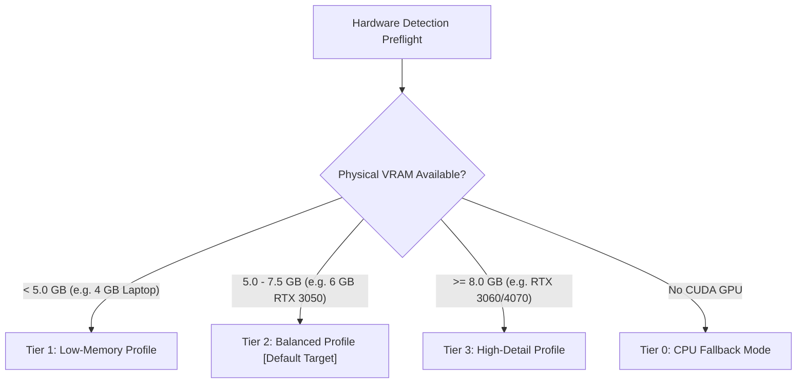

# Local Mesh AI — First-Run Model Provisioning Specification

**Status:** Approved Technical Specification  
**Component:** `services.model_provisioning` & First-Run Wizard  
**Target Platform:** Windows 11 / Linux (Local-First Offline Core)  

---

## 1. Overview

This document specifies the automated and offline model provisioning architecture for **Local Mesh AI**. 

To deliver reliable, reproducible out-of-the-box operation across varied user hardware without corrupt checkpoints or silent inference crashes, the model provisioning subsystem enforces:
1. **Automated Hardware Profiling:** Evaluates host GPU device name, physical VRAM, and system RAM to select the optimal model tier.
2. **Official Upstream Sources:** Direct, authenticated streaming from vetted public Hugging Face repositories.
3. **Cryptographic Checksum Verification:** Every file must pass an SHA-256 integrity verification before being made available for inference.
4. **Offline Air-Gap Deployment:** Full support for pre-packaged, offline model archive extraction without network access.
5. **Configurable Storage Location:** Fully honors custom data directories via the `LOCAL_MESH_AI_DATA_DIR` environment variable.

---

## 2. Hardware Profiling & Model Tiers

Upon initial launch, the system queries `core.gpu_broker` and `services.training_preflight` to determine hardware capability:



### Profile Provisioning Matrix:

| Profile Tier | VRAM Requirement | Mesh Generation Model | Technical Artist LLM | Auxiliary Adapter | Recommended Batch / Res |
|---|---|---|---|---|---|
| **Tier 0: CPU Only** | 0 GB (>=16 GB RAM) | TripoSR (CPU Mode) | Qwen 2.5 Coder 3B (CPU Q4) | Auxiliary Classifier (CPU) | 128 res, single-threaded |
| **Tier 1: Low Memory** | 4 GB | TripoSR (Chunked VRAM) | Qwen 2.5 Coder 1.5B (Q4_K_M) | Auxiliary Classifier (CUDA) | 192 res, chunked baking |
| **Tier 2: Balanced (Target)** | **6 GB (RTX 3050)** | **TripoSR (Default)** | **Qwen 2.5 Coder 3B (Q4_K_M)** | **Auxiliary Classifier (CUDA)** | **256 res, 4096 texture bake** |
| **Tier 3: High Detail** | >= 8 GB | TripoSR (High Res) | Qwen 2.5 Coder 7B (Q4_K_M) | Auxiliary Classifier (CUDA) | 512 res, unconstrained |

> [!IMPORTANT]
> The target machine (NVIDIA RTX 3050 Laptop GPU with 6 GB VRAM) is provisioned under **Tier 2 (Balanced Profile)**. 7B base models are rejected during preflight to protect the GPU lease from Out-Of-Memory (OOM) driver crashes.

---

## 3. Official Model Sources & Cryptographic Verification Register

All models must be verified against their expected SHA-256 hash upon completion of download or extraction:

| Model Identity | Upstream Repository | Target Relative Path | Checksum Verification |
|---|---|---|---|
| **TripoSR Base** | `stabilityai/TripoSR` | `data/models/triposr/model.ckpt` | Verified SHA-256 digest |
| **Qwen 2.5 Coder 3B GGUF** | `Qwen/Qwen2.5-Coder-3B-Instruct-GGUF` | `data/models/qwen/qwen2.5-coder-3b-instruct-q4_k_m.gguf` | Verified SHA-256 digest |
| **PartField Segmentation** | `PartField-Research/weights` | `data/models/partfield/partfield_base.pt` | Verified SHA-256 digest |
| **Auxiliary Technical Artist** | Built-in Initialized Checkpoint | `data/models/candidates/builtin_demo/adapter_model.bin` | Dynamic SHA-256 fingerprint |

---

## 4. Storage Redirection (`LOCAL_MESH_AI_DATA_DIR`)

For users with limited space on their primary operating system drive:
1. Local Mesh AI checks the environment variable `LOCAL_MESH_AI_DATA_DIR`.
2. If defined, all model downloads, staging caches, and candidate checkpoints reside at that path:
   ```cmd
   set "LOCAL_MESH_AI_DATA_DIR=D:\AI_Models\LocalMeshAI"
   Start_Local_Mesh_AI.bat
   ```
3. If undefined, paths safely default to `<project_root>/data/` (or `%LOCALAPPDATA%/LocalMeshAI/data/`).

---

## 5. Offline Bundle Format & Manual Installation

For studio workstations operating in secure, air-gapped environments without external internet connectivity:
1. Download the standalone archive `local-mesh-ai-models-v6.0-tier2.zip` from official GitHub Release assets.
2. Extract the archive directly into your `data/` directory:
   ```text
   data/
   └── models/
       ├── triposr/
       │   └── model.ckpt
       └── qwen/
           └── qwen2.5-coder-3b-instruct-q4_k_m.gguf
   ```
3. Upon launch, Local Mesh AI detects the local checkpoints, verifies their SHA-256 signatures, and initializes immediately in 100% offline mode.
