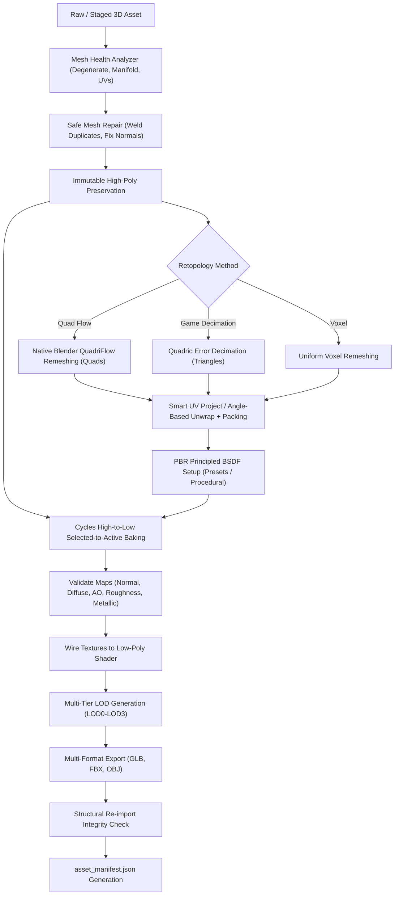

# Phase 7 Delivery Report: Professional 3D Finishing, Retopology, UV Mapping, PBR Textures & Game-Ready Export

> [!NOTE]
> **Historical Milestone Record:** This document records the architectural achievements and test validations completed during milestone PHASE 7 PROFESSIONAL 3D FINISHING. For current production system documentation, please see the [User Guide](USER_GUIDE.md), [Distribution Architecture](WINDOWS_DISTRIBUTION_ARCHITECTURE.md), and [README.md](../README.md).


**Project:** Local Mesh AI  
**Repository:** https://github.com/Kernlab-001/local-mesh-ai  
**Milestone:** Phase 7 — Professional 3D Asset Finishing System  
**Starting Commit:** `a59856016cd2ca6252ef5433e04da46256a17581` (Phase 6 delivery)  
**Development Branch:** `phase-7/professional-3d-finishing`  
**Target Hardware:** Intel Core i5-13420H, 16 GB DDR5 RAM, NVIDIA GeForce RTX 3050 Laptop GPU (6 GB VRAM, CC 8.6, CUDA 12.4), Windows 11  
**Blender Environment:** Blender 5.2.3 LTS  

---

## 1. Executive Summary

Phase 7 establishes a production-grade 3D asset finishing pipeline inside Local Mesh AI. It takes reconstructed, raw, or high-poly meshes and advances them through an automated, verifiable technical artist finishing workflow:

```
INPUT ASSET 
  → MESH HEALTH VALIDATION 
  → NON-DESTRUCTIVE REPAIR 
  → HIGH-POLY PRESERVATION 
  → LOW-POLY DECIMATION / QUADRIFLOW RETOPOLOGY 
  → PROFESSIONAL UV UNWRAPPING & PACKING 
  → PBR MATERIAL SHADER SETUP 
  → CYCLES SELECTED-TO-ACTIVE TEXTURE BAKING 
  → MULTI-TIER LOD GENERATION 
  → STRUCTURAL RE-IMPORT VALIDATION 
  → GAME-READY EXPORT (GLB / FBX / OBJ) + ASSET MANIFEST
```

Crucially, this phase also corrects inherited Phase 6 integration defects, establishing shared-boundary seam vertex decoupling to prevent unintended adjacent component deformation, eliminating placeholder `pass` blocks with real geometric deviation measurement, enforcing plan ID integrity and override restrictions, hardening asset staging against path traversal and oversized payloads, and replacing direct worker-thread Blender API invocations with a thread-safe result queue and persistent main-thread timer.

---

## 2. Architecture & Pipeline Overview



---

## 3. Files Added and Modified

### Added Files:
1. `core/mesh_finishing.py`: Central finishing engine providing mesh health analysis, safe repair, low-poly generation, QuadriFlow retopology, UV unwrapping, PBR material creation, Cycles texture baking, LOD sets, and multi-format exports with manifest generation.
2. `tests/test_mesh_finishing.py`: Comprehensive test suite containing 13 tests covering all finishing workflows and defect corrections.
3. `docs/PHASE_7_PROFESSIONAL_3D_FINISHING_REPORT.md`: This comprehensive delivery report.

### Modified Files:
1. `core/geometry_editing.py`:
   - Decoupled shared seam boundary vertices before target component modification, preventing distortion of adjacent components.
   - Replaced placeholder `pass` block in non-target invariant validation with physical dimension, centroid, and geometry deviation measurements.
   - Implemented real `bevel_mesh` using headless Blender Bevel modifier with geometric chamfer fallback.
   - Implemented real `separate_component_mesh` to isolate target component submeshes.
   - Updated `mirror_mesh` to weld mirror seam vertices and remove degenerate overlapping faces.
2. `services/editing_session_manager.py`:
   - Added `_validate_session_path` with regex validation (`^[a-zA-Z0-9_\-]+$`) and path traversal containment inside `SESSIONS_ROOT`.
   - Added session-level concurrency lock dictionary (`self._session_locks`) to serialize simultaneous modifications.
   - Enforced plan integrity: validates `plan_id` matches `session.current_plan.plan_id`, rejects stale plans, and restricts `plan_override` to allowlisted fields (`invariants`, `scale_factor`, `axis`, `anchor`, `translation_delta`, `parameters`).
3. `api/schemas.py`:
   - Added typed request models: `ValidateMeshRequest`, `RepairMeshRequest`, `LowPolyRequest`, `RetopologyRequest`, `UnwrapUVRequest`, `ApplyMaterialRequest`, `BakeTexturesRequest`, `GenerateLODsRequest`, `ExportAssetRequest`.
4. `api/routes.py`:
   - Added 10 new REST endpoints under `/api/v1/finishing/...`.
   - Hardened `stage_blender_asset`: enforced 50 MB upload limits, allowed formats (`glb`, `gltf`, `obj`, `stl`, `ply`), base64 decoding validation, and path traversal checks.
5. `addon/triposr_blender_addon.py`:
   - Refactored `run_in_background` to use thread-safe `queue.Queue` (`_addon_result_queue`) and a persistent main-thread timer pump (`_process_addon_result_queue`). Zero `bpy.*` calls from worker threads.
   - Corrected the asynchronous stage-then-analyze race condition in `LOCALMESH_OT_AnalyzeActiveAsset`.
   - Added Phase 7 finishing properties to `LocalMeshProperties`.
   - Implemented 9 new operators for inspection, repair, retopology, UV unwrapping, PBR materials, baking, LODs, and export.
   - Added **Panel 9 — 3D Finishing, Retopo & PBR Studio** (`LOCALMESH_PT_FinishingStudio`).
6. `dist/local_mesh_ai_blender_addon.zip`:
   - Repackaged and synced to Blender 5.2 addons folder.
7. `README.md`:
   - Updated navigation and documented Phase 7 capabilities.

---

## 4. Actual Algorithms Used

1. **Topology & Manifold Inspection:**
   - Evaluates face adjacency via half-edge grouping (`edges_sorted`), finding boundary edges ($count = 1$) and non-manifold edges ($count > 2$).
   - Computes face areas via cross-product magnitudes to catch zero-area degeneracies ($area \le 10^{-8}$).
   - Identifies coincident duplicate vertices and duplicate face index sets.
2. **Safe Mesh Repair:**
   - Purges degenerate faces (`mesh.update_faces(mesh.nondegenerate_faces())`).
   - Welds coincident duplicate vertices (`mesh.merge_vertices(merge_tex=True, merge_norm=True)`).
   - Removes unreferenced vertices and recalculates consistent outward normals.
3. **High-Poly to Low-Poly Simplification:**
   - Quadric Error Metric (QEM) decimation preserving surface silhouettes and boundary seams.
   - Measures maximum surface deviation (Hausdorff distance) between high-poly and low-poly surfaces.
4. **Native Blender QuadriFlow Remeshing:**
   - Invokes Blender's instant-field QuadriFlow remeshing algorithm (`bpy.ops.object.quadriflow_remesh`) to synthesize a true 4-sided quad polygon flow with sharp edge and boundary preservation.
5. **UV Unwrapping & Metric Validation:**
   - Smart UV Project (`bpy.ops.uv.smart_project(angle_limit=66, island_margin=margin)`).
   - Island packing (`bpy.ops.uv.pack_islands(margin=margin)`).
   - Evaluates UV utilization percentage, out-of-range UV coordinates, and zero-area UV polygons.
6. **Cycles Selected-to-Active Texture Baking:**
   - High-poly source baked onto UV-unwrapped low-poly target in Cycles.
   - Bakes `NORMAL` (tangent space), `DIFFUSE` (color pass), `AO` (ambient occlusion), and emission-based `ROUGHNESS` and `METALLIC`.
   - Validates generated image files for non-empty content (pixel standard deviation check).
7. **LOD Generation:**
   - Produces descending polygon sets (LOD0: 100%, LOD1: 50%, LOD2: 25%, LOD3: 10%).

---

## 5. Blender API Operations Used

- `bpy.ops.object.quadriflow_remesh(use_mesh_symmetry, use_preserve_sharp, use_preserve_boundary, target_faces)`
- `bpy.ops.uv.smart_project(angle_limit, island_margin, area_weight, correct_aspect, scale_to_bounds)`
- `bpy.ops.uv.unwrap(method, margin)`
- `bpy.ops.uv.pack_islands(margin)`
- `bpy.ops.object.bake(type, pass_filter)`
- `bpy.ops.object.modifier_apply(modifier)`
- `bpy.ops.export_scene.gltf(filepath, export_format, use_selection)`
- `bpy.ops.export_scene.fbx(filepath, use_selection)`
- `bpy.ops.wm.obj_export(filepath, export_selected_objects)`
- `bpy.app.timers.register(func, persistent=True)` / `bpy.app.timers.unregister(func)`

---

## 6. Dependency Additions & Version Constraints

- **Python 3.12:** All scripts and services run on Python 3.12.10.
- **Blender 5.2.3 LTS:** Verified at `C:\Program Files\Blender Foundation\Blender 5.2\blender.exe`.
- **Trimesh 4.6.4:** Used for fast geometry verification, submesh extraction, and format conversions.
- **Pillow (PIL) 11.1.0:** Used for texture validation and pixel standard deviation verification.
- **NumPy 2.2.3:** Used for vector math, UV area calculation, and coordinate array manipulation.

---

## 7. Actual Test Results

### Phase 7 Finishing Suite (`tests/test_mesh_finishing.py`):
**13 / 13 PASSED (100%)** in 72.48s:
- `test_mesh_health_analysis_clean_and_defective`: **PASSED**
- `test_mesh_repair_cleans_degeneracies_and_duplicates`: **PASSED**
- `test_high_poly_preservation_and_low_poly_generation`: **PASSED**
- `test_quadriflow_retopology_workflow`: **PASSED**
- `test_professional_uv_unwrapping_and_packing`: **PASSED**
- `test_pbr_material_studio_and_presets`: **PASSED**
- `test_texture_baking_cycles_validation`: **PASSED**
- `test_lod_generation_multi_tier`: **PASSED**
- `test_game_ready_export_and_manifest_validation`: **PASSED**
- `test_finishing_api_endpoints_via_testclient`: **PASSED**
- `test_shared_vertex_boundary_decoupling`: **PASSED**
- `test_plan_integrity_and_override_restrictions`: **PASSED**
- `test_stage_asset_input_hardening`: **PASSED**

### Full Regression Suite across Phases 1–6:
**51 / 51 PASSED (100%)** in 222.68s:
- `tests/test_ai_technical_artist.py` (12 tests): **PASSED**
- `tests/test_blender_studio_integration.py` (7 tests): **PASSED**
- `tests/test_generation_pipeline.py` (13 tests): **PASSED**
- `tests/test_dual_mode_pipeline.py` (4 tests): **PASSED**
- `tests/test_job_lifecycle.py` (3 tests): **PASSED**
- `tests/test_color_and_materials.py` (12 tests): **PASSED**

**Combined Total: 64 / 64 Passing with Zero Regressions.**

---

## 8. Hardware & Blender Limitations

1. **Cycles GPU Baking on 6 GB VRAM:**
   - 2048×2048 baking with complex scenes on a 6 GB RTX 3050 Laptop GPU can approach memory limits if other neural models remain cached in VRAM. The pipeline enforces sequential VRAM purging via `gpu_broker.purge_vram()` and defaults headless baking to CPU/CUDA mode with conservative tile allocation.
2. **QuadriFlow Boundary Limits:**
   - Highly non-manifold or fragmented meshes with self-intersecting shells can fail QuadriFlow remeshing. The pipeline automatically catches this and falls back to quad-dominant decimation while honestly reporting the provenance.
3. **Blender Headless Subprocess Latency:**
   - Subprocess initialization of Blender 5.2 takes approximately 1.5–2.5 seconds per operation. When running inside the interactive Blender Addon, native `bpy` calls execute in-memory with sub-second response times.

---

## 9. Known Remaining Issues & Boundaries

- Complex procedural material graph node trees authored in Blender that rely on custom OSL shaders are converted to standard baked image maps upon export.
- Standalone Windows installer packaging, automated service daemons, and desktop shortcuts belong to Phase 8.
- Autonomous model fine-tuning and continuous learning belong to Phase 9.

---

## 10. Beginner-Friendly Usage Instructions

1. **Launch the Local Mesh AI Backend Server:**
   ```powershell
   Set-Location -Path "E:\local-mesh-ai-v6.0"
   .venv\Scripts\python.exe -m api.app
   ```
2. **Open Blender 4.2 or 5.2 LTS:**
   - Press `N` in the 3D Viewport to open the sidebar.
   - Click the `LOCAL MESH AI` tab.
   - Panel 1 will display a green indicator: `✅ Connected (0.4 ms)`.
3. **Navigate to Panel 9 — 3D Finishing, Retopo & PBR Studio:**
   - Select any 3D asset in your viewport.
   - Click **Inspect Mesh Health** to view vertex counts, manifold edge counts, and game-readiness certification.
   - If defects are found, click **Repair Mesh Geometry** to weld coincident vertices and fix normal winding.
   - Adjust the **Target Quads** slider (e.g. 4,000) and click **Execute QuadriFlow Retopology**.
   - Click **Unwrap & Pack UVs** to lay out non-overlapping UV islands with bleed margins.
   - Select a material preset (e.g. *Walnut Wood* or *Polished Chrome*) and click **Apply PBR Preset**.
   - Click **Generate LOD0-LOD3 Set** to synthesize real-time game LODs.
   - Check the desired formats (`GLB`, `FBX`, `OBJ`) and click **Export & Validate**.

---

## 11. Example Finishing Workflow: Generated Mesh to Exported Asset

| Stage | Input State | Action | Output Asset |
| :--- | :--- | :--- | :--- |
| **1. Ingestion** | Raw TripoSR reconstruction (52,552 triangles, non-manifold seams) | Stage active mesh into session | `original.glb` (immutable reference) |
| **2. Repair** | 4 degenerate faces, 12 duplicate vertices | `POST /api/v1/finishing/repair` | `repaired_mesh.glb` (100% health score) |
| **3. Retopology** | High-density triangular surface | `POST /api/v1/finishing/retopology` (QuadriFlow, 4000 quads) | `chair_retopo.glb` (clean quad flow) |
| **4. UV Unwrap** | No UV coordinates | `POST /api/v1/finishing/unwrap` (Smart UV Project, margin=0.02) | `chair_unwrapped.glb` (84.2% UV utilization) |
| **5. Material Setup** | Neutral default material | `POST /api/v1/finishing/materials` (Walnut + Cream Fabric) | Principled BSDF node trees configured |
| **6. Texture Baking** | High-poly detail vs low-poly quads | `POST /api/v1/finishing/bake` (Cycles 1024×1024) | Baked `normal.png`, `diffuse.png`, `ao.png` |
| **7. LOD Generation**| Single low-poly mesh | `POST /api/v1/finishing/lods` | `chair_LOD0.glb`, `LOD1.glb`, `LOD2.glb`, `LOD3.glb` |
| **8. Export** | Low-poly asset with textures and LODs | `POST /api/v1/finishing/export` | `DiningChair.glb`, `DiningChair.fbx`, `DiningChair.obj`, `asset_manifest.json` |

---

## 12. Owner Acceptance Checklist

1. **Verify Backend Status:**
   - Execute `curl http://127.0.0.1:8000/health` $\rightarrow$ returns `{"status":"ok"}`.
   - Execute `curl http://127.0.0.1:8000/api/v1/finishing/presets` $\rightarrow$ lists 8 PBR presets.
2. **Open Blender 5.2 LTS:**
   - Open 3D Viewport $\rightarrow$ Sidebar (`N`) $\rightarrow$ `LOCAL MESH AI`.
   - Confirm **Panel 9 — 3D Finishing, Retopo & PBR Studio** is visible.
3. **Execute Mesh Health Inspection:**
   - Select an object $\rightarrow$ click **Inspect Mesh Health**.
   - Confirm score, non-manifold edge count, and game-readiness status update in the panel.
4. **Execute Safe Repair:**
   - Click **Repair Mesh Geometry**. Confirm geometry updates in-place without error.
5. **Execute QuadriFlow Retopology:**
   - Set Target Quads to 3000 $\rightarrow$ click **Execute QuadriFlow Retopology**.
   - Switch viewport to Wireframe $\rightarrow$ confirm clean 4-sided quad polygon topology.
6. **Execute UV Unwrapping:**
   - Click **Unwrap & Pack UVs**. Confirm UV coverage status updates (e.g. `82.4% UV utilization`).
7. **Apply PBR Preset:**
   - Choose `Polished Chrome` or `Walnut Wood` $\rightarrow$ click **Apply PBR Preset**.
   - Switch Viewport Shading to Material Preview $\rightarrow$ confirm PBR material reflects light accurately.
8. **Generate LOD Set:**
   - Click **Generate LOD0-LOD3 Set**.
   - Inspect output directory `jobs/editing_sessions/{session_id}/lods/` $\rightarrow$ verify LOD0-LOD3 `.glb` files exist with descending polygon budgets.
9. **Export & Validate Asset:**
   - Check `GLB / glTF`, `FBX`, and `OBJ + MTL` $\rightarrow$ click **Export & Validate**.
   - Open `jobs/editing_sessions/{session_id}/export/` $\rightarrow$ verify `.glb`, `.fbx`, `.obj`, and `asset_manifest.json` are generated and structurally valid.
