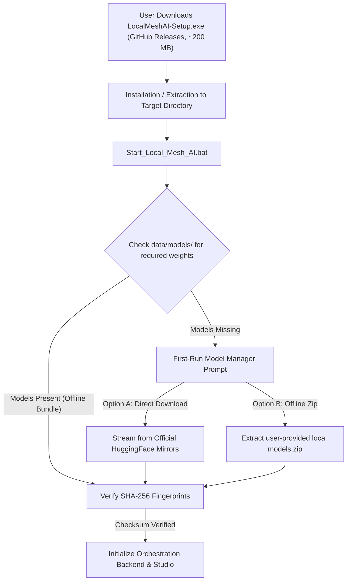

# Local Mesh AI — Windows Distribution & Packaging Architecture Specification

**Status:** Approved Architectural Specification (Pre-Release Phase)  
**Target Platform:** Windows 11 64-bit (x86_64)  
**Hardware Profile:** NVIDIA RTX 3050 Laptop GPU (6 GB VRAM), 16 GB System RAM, Blender 5.2.3 LTS  
**Primary Distribution Channel:** GitHub Releases  

---

## 1. Executive Summary & Objective

This specification establishes the production packaging and release distribution architecture for **Local Mesh AI**. 

To deliver a friction-free consumer installation experience without bloating release downloads or overwhelming bandwidth, Local Mesh AI employs a **decoupled distribution model**:
1. **Core Application Package (`LocalMeshAI-Setup.exe` or portable archive):** Contains the application runtime, Python virtual environment, FastAPI orchestration services, Blender studio addon, and Gradio workspace (~200 MB compressed).
2. **First-Run Model Manager / Offline Model Bundles:** Neural network model weights (TripoSR, Qwen, PartField) are managed dynamically through cryptographic on-demand downloads or optional standalone offline zip archives, never bundled directly into the base code installer.

> [!NOTE]
> In accordance with project milestone rules, this document specifies the production architecture. Compilation of the final commercial binary installer and payment gating is reserved for the post-readiness release milestone.

---

## 2. Directory Layout & Storage Hierarchy

The Windows distribution operates either in **Portable Mode** (self-contained folder on any drive) or **Standard Installed Mode** (under `%LOCALAPPDATA%\LocalMeshAI`):

```text
LocalMeshAI/
├── Start_Local_Mesh_AI.bat          # Master interactive user launcher
├── LICENSE                          # Apache 2.0 Core License
├── README.md                        # Product documentation
├── PRIVACY.md                       # Local-first privacy guarantees
├── SECURITY.md                      # Vulnerability reporting & sandbox safety
├── THIRD_PARTY_NOTICES.md           # Open-source third-party notices
├── MODEL_LICENSES.md                # AI model licensing & provenance register
├── run_server.py                    # Backend orchestration server entrypoint
│
├── runtime/                         # Embedded isolated Python 3.12 64-bit runtime
│   ├── python.exe
│   ├── Lib/site-packages/           # Pre-compiled PyTorch, CUDA, FastAPI, Trimesh
│   └── Scripts/
│
├── addon/                           # Blender 5.2 Studio Addon
│   └── triposr_blender_addon.py     # GPLv3 unified Blender extension
│
├── ui/                              # Standalone Gradio 3D Studio Workspace
│   └── dashboard.py
│
├── core/                            # Engine core, broker, schemas, decompositions
├── services/                        # Lifecycles, preflights, healing, training
├── api/                             # FastAPI REST & WebSocket routes
├── launchers/                       # Diagnostic & developer execution scripts
│
├── data/                            # Persistent user data directory (Excluded from git)
│   ├── models/                      # Base neural checkpoints & GGUF weights
│   │   ├── triposr/
│   │   └── qwen/
│   ├── staging/                     # Active session meshes & temporary bakes
│   ├── learning/                    # Opt-in local instruction pairs
│   │   ├── inbox/
│   │   └── checkpoints/
│   └── recovery_audit.json          # Cryptographic audit logs
│
└── output/                          # User-exported GLB, OBJ, and FBX 3D models
```

---

## 3. Decoupled Model Provisioning Architecture



### Why Decoupling is Essential:
1. **Lean Base Installer:** Allows quick application updates (code, UI, bugfixes) without forcing users to re-download 6–10 GB of neural weights.
2. **Bandwidth Efficiency:** Hugging Face CDN handles high-throughput model serving with resume support (`huggingface_hub`).
3. **Hardware-Tailored Downloading:** The installer detects available GPU VRAM before downloading (e.g. provisioning Qwen 3B Q4_K_M for 6 GB GPUs while avoiding unsupported 7B FP16 checkpoints).

---

## 4. Installer Technology & Build Pipeline

The production installer will be compiled using **Inno Setup** (open-source, highly reliable Windows installer creator):

### Inno Setup Key Configurations:
- **Architecture:** `ArchitecturesInstallIn64BitMode=x64compatible`
- **Privilege Level:** `PrivilegesRequired=lowest` (allows installation without Administrator prompts directly into user profile, or elevated for `Program Files`).
- **Blender Auto-Detection:** Installer scans Windows Registry and default directories for Blender 4.2+ and 5.2 LTS, offering a one-click checkbox to register the addon symlink into:  
  `%APPDATA%\Blender Foundation\Blender\<version>\scripts\addons\local_mesh_ai.py`
- **Desktop & Start Menu Shortcuts:** Creates clean shortcuts for `Start_Local_Mesh_AI.bat`.

---

## 5. Upgrade & Uninstallation Safeguards

- **Mesh Protection:** Uninstallation strictly preserves `output/` and `data/` directories to prevent accidental deletion of user artwork, textures, or training data.
- **Atomic File Rollback:** Temporary setup files are verified in a staging directory prior to overwriting core binaries.
